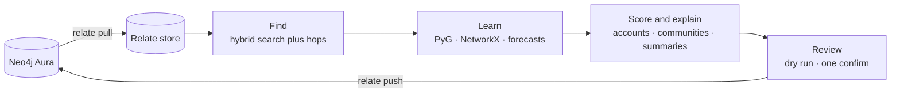

# subgraph-lab

Pull a subgraph from Neo4j Aura into Relate, let open-source models learn from it, and push the results back.

## Why this exists

A graph holds a whole population. Most of its value gets added on top, run after run: a risk score on every
account, an embedding on every node, an alert with a reason when something changes. Today, finding the part of
the graph worth working on is a one-off query, and getting that part into PyTorch Geometric or NetworkX and the
results back into Neo4j is a one-off script, with no record of what changed.

Relate's docs describe the round trip: pull a subgraph from Aura into Relate for a task, push the results back.
subgraph-lab is that round trip with learning in the middle. Pull a slice, find the part that matters with hybrid
search, hand it to the models the open-source community already maintains, review a dry run, push. Then the next
slice.



> **Read [`architecture-docs/`](architecture-docs/README.md) first.** Everyone, people and AI agents alike,
> starts there before reading or changing any code. [`99-build-status.md`](architecture-docs/99-build-status.md)
> says what is built.

## What it does

A) **Pull and push.** `relate pull` into a fresh store. `relate push` back on keys, after a dry run. Never deletes.

B) **Find.** Vector and full-text search in one statement, fused by rank, then a few hops. That subgraph is the slice.

C) **Hand off.** Adapters to PyTorch Geometric, the Temporal Graph Benchmark layout, NetworkX and Arrow. No model code of our own.

D) **Score.** Risk factors in a YAML file anyone can extend. A policy file makes account scores. Communities get their own.

E) **Explain.** The riskiest communities get a summary of why, written only from checked evidence, with the innocent explanation to rule out.

F) **Review and push.** The dry-run plan plus the delta, one confirm, a manifest that resumes. Reviewer decisions go back with it.

G) **The app and the agent.** Seven screens. An agent reads through Relate's MCP server and acts through the lab's tools.

H) **Demo data.** A generator with planted rings and legitimate look-alikes, so scores cannot be perfect.

## Status

Nothing is built as of 12 November 2026. The design is in `architecture-docs/`. Code lands in `lab/`, `app/`,
`examples/`, `factors/` and `generator/`. Every number in the docs comes from a vendor's documentation or is
marked "to measure".

Built with Relate by Neo4j, for the Relate by Neo4j hackathon, due 11 December 2026. AI agents build the tracks
in parallel and one person integrates; the submission says how. MIT, see [`LICENSE`](LICENSE).

## Run, once it exists

```
cp .env.example .env     # NEO4J_URI, NEO4J_USERNAME, NEO4J_PASSWORD, NEO4J_DATABASE
docker compose up        # the lab on http://localhost:8000
```

`docker compose --profile local up` adds a bundled Neo4j with the seed data, for anyone without an Aura
account. Ports and settings are on [07](architecture-docs/07-what-runs-where.md).
