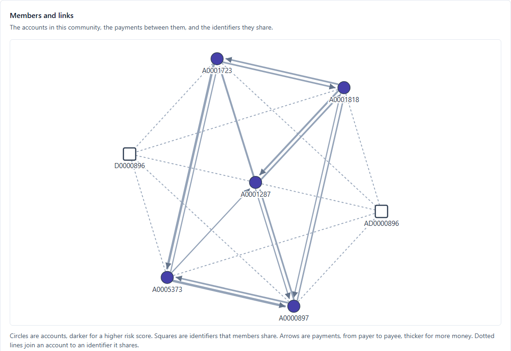
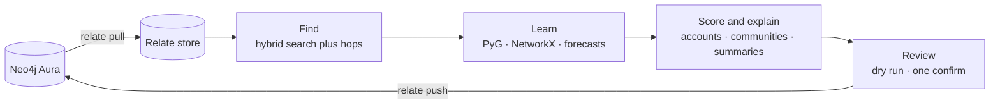

# subgraph-lab

Pull a subgraph from Neo4j into Relate, let open-source graph models learn from it, review the dry run, push the
results back. Built with Relate by Neo4j.



**[The walkthrough](https://github.com/EastridgeAnalytics/subgraph-lab/blob/main/demo/README.md)**, one planted
fraud ring followed from the graph to a score, a written reason, a reviewer's decision and back into Neo4j, with
the screenshots from one real run · **[The agent](demo/agent.md)**, Claude Code doing the same job through the two
MCP servers, from its own log · **[Inspect the store](demo/README.md#inspect-it-yourself)**, five minutes with the
`relate` CLI and nothing else to install · **[Run it](#run)**, one compose command.

## What you will see

The demo bank is synthetic: 10,000 accounts with their devices, emails and addresses, 120,000 payments, 60 planted
fraud rings and 60 honest look-alike groups, with the answer key written down. The lab pulls a slice of it, scores
every account, groups the accounts into communities, writes down why each community could be risky, and pushes the
results back after one confirm.

Ring R0006 comes out as the top community of 172, at 0.84, and it is exactly the ring's five members. Its summary
names the innocent explanation to rule out first: a household, or a shared computer. A reviewer marks it confirmed,
and the push lands it in Neo4j under its run id. Across the slice,
[against the answer key](demo/README.md#how-the-whole-slice-did):

- all 39 communities scoring 0.6 or more hold planted ring accounts;
- none of the 60 look-alike groups scores that high;
- 210 of the 211 alerts are on planted ring accounts.

The data is built to be found, so these numbers say the lab finds what it was built to find. What they show is the
whole loop working.

## Connected context

The models never see a table of accounts. They see the accounts with the devices, emails and addresses they share
and the money between them, pulled from Neo4j as one subgraph into a Relate store. Communities form from those
links: shared identifier first, then money forwarded within a day, then payments. The score's parts are those
links, with the arithmetic shown. The summary is written only from a checked evidence object of them, so every
number in it is in the graph.

An agent gets the same subgraph. It reads through Relate's MCP server, read-only, and acts through the lab's nine
tools, where the one write to the master graph sits behind a confirm. An agent that understands how the data
connects can show the connections it used. Every summary and every push here has to pass that test.

## Why it matters

- **For a Neo4j team.** The graph holds the whole population, and the value gets added on top, run after run.
  This adds it a slice at a time, with the models the open-source world already maintains, and pushes it back to
  Aura with a record of what changed.
- **For whoever answers for the data.** The dry run and the delta come first, then one confirm. Every write
  carries a run id, a re-run replaces only its own results, nothing is ever deleted, and a run can be retracted.
- **For an agent.** It can read everything and change nothing without the gate.

## Fraud today, other verticals next

We build graph fraud detection on Neo4j for a living. Tim Eastridge, who leads Eastridge Analytics, is a Neo4j
certified expert, a Neo4j Ninja, and the author of *Graph Data Science with Python and Neo4j*. The team has five
certified Neo4j experts. The largest graph we run is fraud detection and entity resolution for federal
pandemic-spending oversight (PRAC), at over 200 million nodes.

The factors, the community score and the evidence-first summaries here come from that work. No client's code,
schema or name is in this repo. Every one of those engagements wanted the same loop: try a model on part of the
graph, see the ring, and write the result back with a record of what changed. This is that loop, in the open.

Nothing in the loop is specific to fraud except `factors.yaml` and the generator. The next step is a pack per use
case, each a recipe, a factor file, an example and a review checklist: financial crime, churn, supply chain and
identity, on the 2.0 row of [99](architecture-docs/99-build-status.md). Same pull, same review, same push to Aura,
and [the agent](demo/agent.md) runs them unchanged. That is the plan. Today the lab ships the fraud pack.

## How it uses Relate

| Relate feature | What the lab does with it | Where |
|---|---|---|
| `relate pull` | A slice from the master graph into a fresh store per run, over the Query API. Parallel Bolt is the fallback, and the route taken is on the manifest | `lab/roundtrip/pull.py` |
| `relate-db` in Python | Opens the store; loads results with `UNWIND` batches that size themselves | `lab/common/store.py`, `lab/roundtrip/loader.py` |
| Vector and full-text indexes | Recreated after every pull, on Node2Vec embeddings and short summaries of every account and community | `lab/roundtrip/indexes.py`, `lab/slice/first_pass.py` |
| Hybrid search in one statement | A vector branch and a full-text branch, fused by rank, then hops. That subgraph is the slice | `lab/slice/search.py` |
| `relate serve --read-only=live` | The app and the agent read the store while the lab writes it, over HTTP, Bolt and MCP | `lab/api/relate_server.py` |
| `relate push --dry-run`, then `relate push` | The plan before the write. Keyed merges in batches, a manifest that resumes, `LabRun` written last | `lab/roundtrip/push.py` |
| The skill and the MCP server | `relate skill install`; the agent reads the evidence through `read_cypher` | `lab/api/mcp_tools.py` |
| `relate clone` | The demo run's store, committed as one `.rl` file | `demo/store.rl` |

Every row was run against Relate 1.0.1 before the code was written:
[the wave 0 check](architecture-docs/reviews/wave-0-relate-1.0.1.md).

## How the pieces fit



| Step | Code | Page | Tests |
|---|---|---|---|
| The demo bank, with planted rings | `generator/` | [07](architecture-docs/07-what-runs-where.md) | `test_generator.py` |
| Pull into a fresh store | `lab/roundtrip/pull.py`, `loader.py` | [01](architecture-docs/01-the-round-trip.md) | `test_pull.py`, `test_loader.py` |
| First pass: embeddings, summaries, indexes | `lab/slice/first_pass.py`, `lab/roundtrip/indexes.py` | [02](architecture-docs/02-the-slice.md) | `test_first_pass.py`, `test_indexes.py` |
| The slice: by schema, by Cypher, by search | `lab/slice/search.py`, `estimate.py` | [02](architecture-docs/02-the-slice.md) | `test_search.py`, `test_estimate.py` |
| Adapters: table, PyG, TGB events, NetworkX, series | `lab/adapters/` | [03](architecture-docs/03-models-and-adapters.md) | `test_adapters.py` |
| The examples: Node2Vec, TGN, NetworkX, velocity | `examples/` | [03](architecture-docs/03-models-and-adapters.md) | `test_tgn.py`, `test_networkx_example.py`, `test_velocity.py` |
| Factors, policy, account scores, alerts | `factors/`, `lab/scoring/` | [04](architecture-docs/04-risk-scores.md) | `test_factors.py`, `test_policy.py` |
| Communities and their score | `lab/scoring/communities.py`, `community_score.py` | [04](architecture-docs/04-risk-scores.md) | `test_communities.py`, `test_community_score.py` |
| Evidence and summaries | `lab/summaries/` | [05](architecture-docs/05-summaries.md) | `test_evidence.py`, `test_summaries.py` |
| Stage, dry run, delta, push, retract | `lab/roundtrip/stage.py`, `push.py`, `delta.py`, `retract.py` | [01](architecture-docs/01-the-round-trip.md) | `test_stage.py`, `test_push.py`, `test_delta.py` |
| The API and the nine tools | `lab/api/` | [06](architecture-docs/06-the-app-and-the-agent.md) | `test_mcp.py` |
| The seven screens | `app/src/screens/` | [06](architecture-docs/06-the-app-and-the-agent.md) | `npm test` |
| One run, pull to push | `lab/pipeline.py` | [00](architecture-docs/00-overview.md) | `test_pipeline.py`, `tests/acceptance/loop.py` |

Tests are in `tests/`. Each code folder has a README that says what is in it.

## AI in the product, and AI that built it

**In the product.** An agent connects to two MCP servers: Relate's, serving the run's store read-only and
following the lab's writes, and the lab's, with nine tools from `egress` to `apply_push`. `apply_push` fails
without `confirm=true`, and without a review newer than the last thing staged. The summaries are written by Claude
through the Anthropic API when a key is set, by the agent through `describe_alert`, or by a template. All three
write from the same evidence object and pass the same checks: every number in the text is in the evidence, every
member named is a member, no verdict words. A summary that fails the checks falls back to the template and says so.
[`demo/agent.md`](demo/agent.md) is one recorded session of Claude Code finding and pushing a ring this way.

**In the build.** One Claude Opus session directed it from [the development plan](architecture-docs/97-development-plan.md).
Claude Sonnet builders took one written brief each, in their own git worktrees, up to three at a time. Nothing
merged without its test on the seed. The director ran the whole loop after every merge, reviewed the codebase
against the pages, and briefed the fixes. Each wave's report is in
[`architecture-docs/reviews/`](architecture-docs/reviews/). One person owns the project and reviews it.

## Three ways in

1. **Look, two minutes.** [The walkthrough](demo/README.md), and [the agent](demo/agent.md) doing the same job.
   The video follows the shot list on [video.md](architecture-docs/video.md).
2. **Inspect, five minutes.** [`demo/store.rl`](demo/README.md#inspect-it-yourself) is the store from that run.
   `relate info`, four queries, and `relate serve --mcp` so Claude can read it.
3. **Run, fifteen minutes.** Below.

## Run

```
git clone https://github.com/EastridgeAnalytics/subgraph-lab
cd subgraph-lab
cp .env.example .env                 # change the ports in it if another Neo4j already uses them
docker compose --profile local up    # builds the image, makes the seed, starts Neo4j and the lab
```

Open `http://localhost:8000`, then Connect, Slice, Run, and Review and push. The first build downloads PyTorch for
CPU; its time and the image's size are on [98](architecture-docs/98-measured.md).

With Aura instead of the bundled Neo4j, set `NEO4J_URI`, `NEO4J_USERNAME` and `NEO4J_PASSWORD` in `.env` and run
`docker compose up`. Ports and every setting are on [07](architecture-docs/07-what-runs-where.md).

## What is measured, and what waits

702 unit tests on a fixture graph, 35 live tests against Neo4j, 254 app tests, and A1 to A11 from
[the requirements](architecture-docs/88-product-requirements.md) in [`tests/acceptance/`](tests/acceptance/).
Every number in the docs is on [98](architecture-docs/98-measured.md) with the run that produced it, on one
named machine: a pull of one million relationships takes 124 seconds by `relate pull`, and the loop from a clean
clone to a reviewed push takes 160 seconds after the first image build. Waiting: the Aura rows on 98 and test A7,
which need credentials; summaries by API, which need a key; the video.

## Working on the code

Read [`architecture-docs/`](architecture-docs/README.md) first, people and agents alike.
[99](architecture-docs/99-build-status.md) says what is built and [08](architecture-docs/08-decisions.md) what was
decided. `uv sync`, then `uv run python tools/install_relate.py` for the Relate CLI, `uv run pytest -q`, and
`npm test` in `app/`. A change that makes a page wrong changes the page in the same commit.

MIT, see [`LICENSE`](LICENSE). Built with Relate by Neo4j, for the Relate by Neo4j hackathon.
