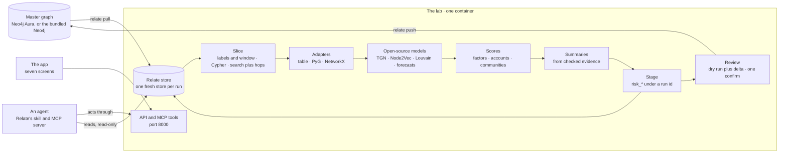

# 00 · Overview

subgraph-lab runs beside Neo4j Aura. It pulls a subgraph into Relate, finds the part that matters with hybrid
search, scores accounts and the communities they form, writes a checked summary of why a community could be
risky, and pushes the results back after a dry run. Then it takes the next slice.

## The picture

## The loop

1. **Pull.** `relate pull` copies whatever a Cypher query returns from Aura into a fresh Relate store.
2. **Find.** Hybrid search picks the starting accounts. A few hops pick up what is connected. That is the slice.
3. **Hand off.** An adapter turns the slice into a table, a PyTorch Geometric object or a NetworkX graph.
4. **Score.** Rules, forecasts and a model each produce risk factors. A policy file combines them into an account
   score. Communities form inside the slice and get their own score.
5. **Explain.** The top communities get a short summary of why they could be risky, written from an evidence
   object that was checked first.
6. **Review.** `relate push --dry-run` prints the plan. The lab adds the delta. A person confirms.
7. **Push.** `relate push` merges on keys, in batches, and creates the new nodes. Then the next slice.

## What holds everywhere

- **Nothing is ever deleted on the master graph.**
- **Nothing reaches the master graph until a person, or an agent with confirm set, says so.**
- **Every write carries a run id. A re-run replaces its own results and touches nothing else.**
- **Three formats out (a table, a PyTorch Geometric object, a NetworkX graph). One format in (a table with a key column).**
- **Every number in a summary comes from the evidence it was written from.**
- **Nothing leaves the container unless Aura or model credentials are set.**
- **The lab is the only writer to the Relate store. Relate serves it to the app and the agent read-only.**

## What Relate does here

| Relate feature | Where you see it |
|---|---|
| `relate pull` | Run: a slice from Aura into a fresh store |
| `relate push`, dry run first | Review and push |
| Keyed merge that creates nodes | New `Alert` and `RiskCommunity` nodes in Aura |
| Hybrid search with rank fusion | Slice by search; "similar accounts" and "communities like this one" on Results |
| Hops after a search | The subgraph around each hit |
| Vector and full-text indexes | Embeddings and summaries, searchable |
| Cypher on the working copy | As-of queries on the Timeline; fan-in and cycle checks |
| `relate serve --read-only=live` | The app and the agent read while the lab writes |
| The skill and the MCP server | The agent reads evidence through `read_cypher` |
| Arrow results | The table adapter |
| `DO_NOT_TRACK=1` | Every container |

Every row is from Relate's docs. Whether `--read-only=live` follows another writer is to verify in week one.

## Words we use

| Word | Means |
|---|---|
| master graph | The full graph in Aura or Neo4j, the system of record. The lab reads slices from it and writes results back to it |
| slice | Part of the graph, picked by labels and a window, by Cypher, or by search: these accounts and everything within two hops |
| Relate | Neo4j's embedded graph database. It runs inside the lab, speaks Cypher, holds the slice, and pulls from and pushes to Neo4j |
| hybrid search | A vector search and a full-text search run together, their results merged into one ranked list |
| rank fusion | The merge: each hit scores 1 / (60 + its rank) in each list, and the scores add up |
| dry run | `relate push` printing what it would write, without contacting Aura |
| risk factor | One reason an account could be risky, scored 0 to 1, with its evidence. A rule, a forecast or a model produces it |
| community | A group of accounts more tightly linked to each other than to the rest of the slice, by payments or shared identifiers |
| disposition | The reviewer's decision on an account or community: confirmed, false positive, needs more |
| run id | The id stamped on every write from one run |
| recipe | A saved setup of one loop: the slice, the models and factors, what to write back |
| adapter | The few lines that turn the slice into the format a library expects |
