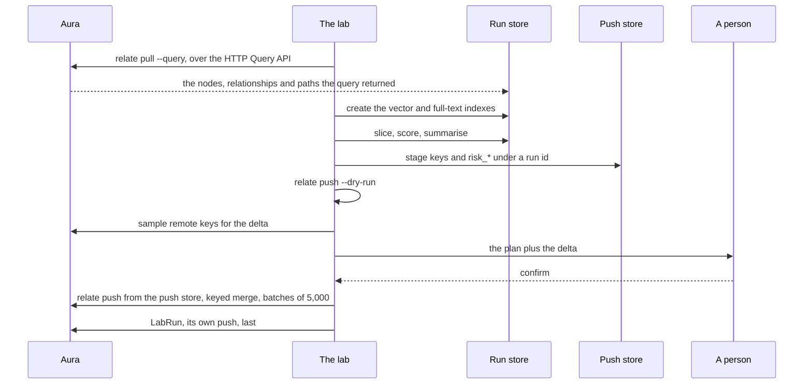

# 01 · The round trip

A slice goes from Aura into Relate, gets enriched, and comes back as a keyed merge after a dry run. Every Relate
behaviour on this page was run against Relate 1.0.1 in wave 0 ([review](reviews/wave-0-relate-1.0.1.md)) unless
it says "to measure".

## Pull

`relate pull --query Q --database PATH` copies whatever the Cypher returns, nodes, relationships or paths, into a
Relate store over Neo4j's HTTP Query API v2. The uniqueness constraints on the pulled labels come with it.

- **The destination must be empty, so every run gets a fresh run store.**
- **The lab creates the vector and full-text indexes after every pull.**
- One checkpoint, after the last statement.
- Relate reads `NEO4J_URI` as an `http(s)` Query API address. The lab passes it `NEO4J_QUERY_URI`, derived from
  the Bolt `NEO4J_URI` when unset, and adds `--allow-plaintext` only for an `http://` address.
- No batching or timings are documented. A pull at 100k and at 1M relationships is measured in wave 6. To measure.
- The fallback is parallel Bolt reads, used when the Query API is not reachable. The route taken is recorded on
  the run.

## Stage

Results come back from a model or a rule as one table with a key column. The lab writes that table into a
**push store**: a second Relate store per run that holds only keys, `risk_*` properties, `Alert`,
`RiskCommunity` and `LabRun` nodes, and their links, with a uniqueness constraint per label.

- **One format in: a table with a key column.**
- **The pulled store is never pushed.** It would re-send every pulled property, and payments between the same two
  accounts would merge into one.
- **Timestamps in the push store are UTC ISO-8601 strings.** `relate push` 1.0.1 fails on zoned datetimes.
- One commit cannot exceed 64 MiB. The loader starts at 20,000 rows, raises until refused, and backs off by half.
- Alert keys are `sha1(run_id | account_id | window)`. Community keys are `sha1(run_id | lowest member key)`.
- The library is `relate-db` on PyPI, pinned at 1.0.1.

## Review

`relate push --dry-run --json` prints the plan without contacting Aura. The plan is not a diff against Aura, so the
lab adds one: it samples the remote for keys that are missing or changed, and shows new alerts and communities,
scores that moved grouped by size, vectors, and bytes to send.

- **A person sees the plan and the delta before anything is sent.**
- **One confirm. `apply_push(confirm=true)` is the only code path that writes to the master graph.**

## Push

`relate push --to CREDS --database PUSH_STORE` merges on keys in batches of 5,000 by default. Keys come from the
push store's uniqueness constraints. A keyed merge creates nodes that do not exist yet, which is how `Alert` and
`RiskCommunity` nodes and their links reach Aura. A label with no key is skipped and reported, never guessed.

- **Push never deletes. Retractions, when a run needs them, go over Bolt.**
- Push stops at the first failing batch and names the batch, the row range and the statement. `relate push` has no
  resume flag, so the manifest records which entities landed and a resume pushes the rest. A resent batch is
  harmless: the merge is keyed.
- Pushing the same run twice changes nothing the second time.
- `LabRun` is its own push, after everything else lands, with counts, the model hash and the factor file version.
  If it is there, the run landed whole.
- Reviewer decisions travel with the push as `risk_disposition`, with who and when.
- The Bolt fallback writes scores in batches of 5,000 to 10,000 and vectors in batches of 1,000 to 2,000.

## The same Cypher on both sides

A slice query, a pattern check or an as-of filter written against the Relate store runs on Aura unchanged. Relate
holds the working copy so that stays true.

## Known gaps

Pull and push were run against a local Neo4j 2026.08.1 in wave 0, not yet against Aura. The Aura columns on the
measured page wait for credentials.

## Where it lives

`lab/roundtrip/`: pull, the stores, the loader, the delta, push, the manifest.
