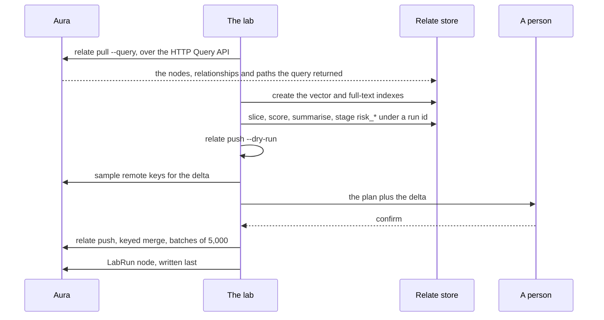

# 01 · The round trip

A slice goes from Aura into Relate, gets enriched, and comes back as a keyed merge after a dry run. Every step on
this page is from Relate's docs unless it says "to measure".

## Pull

`relate pull --query Q --database PATH` copies whatever the Cypher returns, nodes, relationships or paths, into a
Relate store over Neo4j's HTTP Query API. Credentials come from `NEO4J_URI`, `NEO4J_USERNAME`, `NEO4J_PASSWORD`
and `NEO4J_DATABASE`.

- **The destination must be empty, so every run gets a fresh store.**
- **Pull skips vector and full-text indexes. The lab recreates them after every pull.**
- One checkpoint, after the last statement.
- No batching or timings are documented. Week one measures a pull at 100k and at 1M relationships. To measure.
- The fallback is parallel Bolt reads, used when the Query API is not reachable. The route taken is recorded on
  the run.

## Stage

Results come back from a model or a rule as one table with a key column. The lab writes that table into the
Relate store through Relate's Python library in `UNWIND` batches, under the run id, in `risk_*` properties.

- **One format in: a table with a key column.**
- One commit cannot exceed 64 MiB. The loader starts at 20,000 rows, raises until refused, and backs off by half.
- Alert keys are `sha1(run_id | account_id | window)`. Community keys are `sha1(run_id | lowest member key)`.
- The library is on GitHub releases, not PyPI. The release URL and checksum are pinned.

## Review

`relate push --dry-run` prints the plan without contacting Aura. The plan is not a diff against Aura, so the lab
adds one: it samples the remote for keys that are missing or changed, and shows new alerts and communities,
scores that moved grouped by size, vectors, and bytes to send.

- **A person sees the plan and the delta before anything is sent.**
- **One confirm. `apply_push(confirm=true)` is the only code path that writes to the master graph.**

## Push

`relate push --to CREDS --database PATH` merges on keys in batches of 5,000 by default, with
`--merge-key Label:property` per label. A keyed merge creates nodes that do not exist yet, which is how `Alert`
and `RiskCommunity` nodes and their links reach Aura.

- **Push never deletes. Retractions, when a run needs them, go over Bolt.**
- Push stops at the first failing batch with a partial report. The lab keeps a manifest per batch, so a stopped
  push resumes from the first unfinished one.
- Pushing the same run twice changes nothing the second time.
- A `LabRun` node is written last, with counts, the model hash and the factor file version. If it is there, the
  run landed whole.
- Reviewer decisions travel with the push as `risk_disposition`, with who and when.
- The Bolt fallback writes scores in batches of 5,000 to 10,000 and vectors in batches of 1,000 to 2,000.

## The same Cypher on both sides

A slice query, a pattern check or an as-of filter written against the Relate store runs on Aura unchanged. Relate
holds the working copy so that stays true.

## Known gaps

Relate's CLI pages for pull and push say they were written from the CLI specification and not run against a live
server. Week one runs both against Aura, and this page gets the numbers.

## Where it lives

`lab/roundtrip/`: pull, the loader, the delta, push, the manifest. Planned.
