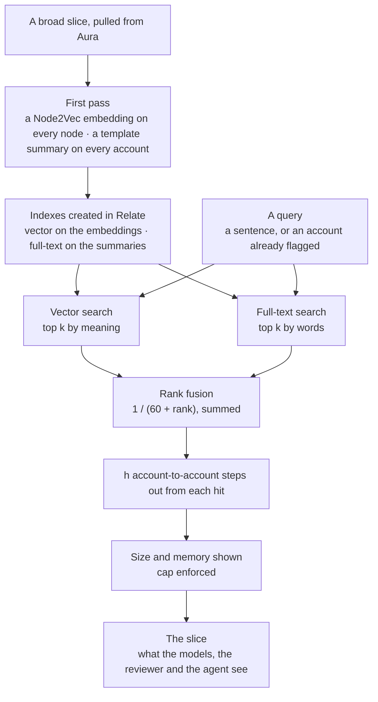

# 02 · The slice

Short version: search picks the starting accounts, hops pick up what is connected, and that subgraph is what the
models enrich.



## Three ways to slice

| Way | What you give | When |
|---|---|---|
| By schema | Labels, relationship types and a time window | A whole period, every account in it |
| By Cypher | Your own query | You already know the shape |
| By search | A sentence, or an account, plus `k` and `h` | You know what you are looking for, not where it is |

The first two are ordinary `relate pull` queries. The third is the one this page is about.

## The order of work

1. Pull a broad slice from Aura. Pull skips vector and full-text indexes, so the lab creates them after.
2. First pass: an embedding on every node from its neighbours (Node2Vec from PyTorch Geometric), and a short
   template summary on each account from its recent activity.
3. Create the vector index on the embeddings and the full-text index on the summaries.
4. Search: vector and full-text in one statement, fused by rank, top `k` hits.
5. Expand `h` account-to-account steps from each hit. Show the size and the memory before going further.
6. Enrich that subgraph. Then review and push.

- **Search is not offered until the first pass has run. The Slice screen says so.**
- **A hop is one account-to-account step** (decision 41): to an account that paid or was paid by this one, or to one
  that shares an identifier with it. An identifier shared by more than `LAB_SHARED_MAX` accounts is no step. The
  identifier nodes are not steps; they come into the slice with the accounts that use them.
- **`k` defaults to 50 and `h` to 1. Both are knobs.** Measured in wave 5c on the store of run
  `run-20261113T082716Z-52f819` (9,932 accounts), for the demo query: `h` 1 from the 50 hits reaches 821 accounts
  and `h` 2 reaches 6,555. The payment graph is dense, so a second step is most of the store.

## The shape of the query

```cypher
CALL () {
  MATCH (a:Account) SEARCH a IN (VECTOR INDEX account_embedding FOR $v LIMIT $k) SCORE AS score
  WITH a ORDER BY score DESC WITH collect(a) AS hits
  UNWIND range(0, size(hits) - 1) AS rank
  RETURN hits[rank] AS a, rank, 'vector' AS src
  UNION ALL
  MATCH (a:Account) SEARCH a IN (FULLTEXT INDEX account_summary FOR $q LIMIT $k) SCORE AS score
  WITH a ORDER BY score DESC WITH collect(a) AS hits
  UNWIND range(0, size(hits) - 1) AS rank
  RETURN hits[rank] AS a, rank, 'fulltext' AS src
}
WITH a, sum(1.0 / (60 + rank)) AS rrf, collect(src) AS found_by
ORDER BY rrf DESC LIMIT $k
RETURN a, rrf, found_by
```

This runs on Relate 1.0.1 as written. Each branch ranks its own hits; the ranks are fused because the two lists'
raw scores are not comparable. The hop is a second statement over the hits' keys, so the estimate can run first.

## What the Slice screen shows first

The hits with their scores and which list found them. The hop count. The nodes and relationships after
expansion. The memory it will take. Then the button.

## Limits, from Relate's docs

- Every search needs a `LIMIT`.
- A vector search can filter only on properties declared on its index.
- Full-text has no stemming. "transfer" does not match "transfers". The vector list covers that.
- One search per `MATCH`.
- Two steps from 50 hits in a dense graph can be most of it (6,555 of 9,932 accounts on the seed, run
  `run-20261113T082716Z-52f819`). The screen shows the size first and enforces a cap. Lower `k` or `h`.
- A search can return fewer than `k` hits when fewer accounts match. The estimate's note says so.

## Where it goes next

Community summaries written later ([05](05-summaries.md)) go into the same full-text index, and each community
gets an embedding, the average of its members'. "Communities like this one" is the same hybrid search again.

## Where it lives

`lab/slice/`: the three slicers, the first pass, the index creation, the estimate. Planned.
