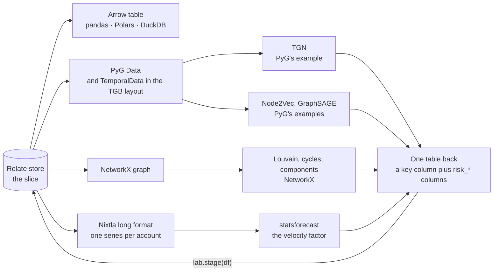

# 03 · Models and adapters

The lab has no model code of its own. It turns the slice into the formats the open-source libraries expect, runs
their own examples, and takes back one table.

- **Three formats out: a table, a PyTorch Geometric object, a NetworkX graph. One format in: a table with a key column.**
- **An example is the library's own example with a few lines changed at the end: `lab.stage(df)`, then `lab.push()`.**
- **Each example is under 100 lines and has a test on the seed data.**

## The adapters

| Adapter | Gives | Used by |
|---|---|---|
| none | An Arrow table. Relate returns Arrow, so pandas, Polars and DuckDB read it directly | Anything tabular |
| `to_pyg()` | A PyG `Data` object: node features, edge index, timestamps | Node2Vec, GraphSAGE, GNNExplainer |
| `to_temporal()` | A PyG `TemporalData` object, the same `src, dst, t, msg` arrays the Temporal Graph Benchmark uses | TGN, and any model on the TGB leaderboard |
| `to_networkx()` | A NetworkX graph, weighted by relationship kind | Louvain, cycles, connected components |
| `to_series()` | A Cypher aggregation per account, in Nixtla's long format | statsforecast |

## The four examples in the MVP

| Example | What it produces | Lands as |
|---|---|---|
| TGN | A score per account from timed payment events | The `tgn` risk factor |
| Node2Vec | An embedding per node | The vector index behind search and "similar accounts" |
| NetworkX communities and cycles | Communities per slice; money cycling inside a group | `RiskCommunity` nodes; an input to the community score |
| statsforecast velocity | Outflow against the account's own forecast | The `velocity_anomaly` risk factor |

## The libraries

Licences read on PyPI on 12 November 2026 unless marked.

| Library | Version | Licence | When |
|---|---|---|---|
| PyTorch Geometric | 2.8 | MIT | MVP |
| Temporal Graph Benchmark (`py-tgb`) | 2.3 | No licence field on PyPI. Read the repo's LICENSE before the name goes in a README | MVP, as a layout |
| Nixtla statsforecast | 2.1 | Apache 2.0 | MVP |
| NetworkX | 3.7 | BSD 3-clause | MVP |
| Polars, DuckDB, pandas | | To confirm on PyPI | MVP |
| PyTorch Geometric Temporal | 0.56 | MIT. Last release July 2025, so pin it | Later, `to_signal()` |
| DGL | 2.2 | Apache 2.0 | Later, `to_dgl()` |
| Neo4j GDS Python client | | To confirm | Later, a second pull and push route where GDS or Aura Graph Analytics exist |

NetworkX does the community work. igraph and leidenalg are GPL and stay out of the image.

## What NOT to expect

- No training loop of our own. The TGN example trains the way PyG's example trains, on CPU by default.
- No accuracy claim on real fraud. The demo data is synthetic, and the measured page reports precision and recall
  on it, whatever they turn out to be.
- No GPU unless the `gpu` compose profile is on.

## Where it lives

`lab/adapters/` for the five adapters, `examples/` for the four examples. Planned.
