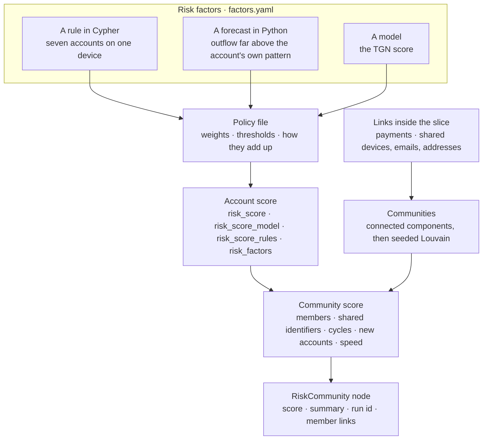

# 04 · Risk scores

Every account gets a score. Every community gets a score. Both are built from risk factors that anyone can add
to a file.



## Three levels

| Level | What it is | Where it lands in Aura |
|---|---|---|
| Risk factor | One reason, scored 0 to 1, with its evidence. A Cypher rule, a Python function or a model produces it | Inside the evidence, not as its own property |
| Account score | The factors combined by the policy file as a noisy-or: a factor that does not fire changes nothing, and a new one can only add. Every part stays visible | `risk_score`, `risk_score_model`, `risk_score_rules` and `risk_factors` on the Account |
| Community score | Built from the members and the shape of the group: how many members score high, the identifiers they share, money cycling inside the group, the share of new accounts, how fast money moves through | A `RiskCommunity` node with its score and summary, linked to its members |

## Adding a factor

A factor is one entry in `factors/factors.yaml`. The file is versioned and checked against a schema.

```yaml
- id: shared_device_5plus
  name: Five or more accounts on one device
  kind: cypher
  query: shared_device.cypher
  threshold: 5
  weight: 0.20
- id: new_accounts_shared_identifier
  name: New accounts sharing an identifier
  kind: cypher
  query: new_accounts_shared_identifier.cypher
  threshold: 3
  weight: 0.65
- id: in_and_out_within_a_day
  name: Money in and out of similar size within a day
  kind: cypher
  query: in_and_out_within_a_day.cypher
  threshold: 3
  weight: 0.65
- id: just_under_threshold
  name: Payments just under 10,000
  kind: cypher
  query: just_under_threshold.cypher
  threshold: 3
  weight: 0.65
- id: fan_in_new_accounts
  name: Fan-in from new accounts
  kind: cypher
  query: fan_in_new_accounts.cypher
  threshold: 5
  weight: 0.20
- id: velocity_anomaly
  name: Outflow far above the account's own forecast
  kind: python
  function: lab.scoring.velocity:score    # statsforecast
  weight: 0.05
- id: tgn
  name: Temporal model score
  kind: model
  source: examples/tgn
  weight: 0.05
```

- **Add an entry, re-run the recipe, and the new factor is in every score and every summary. No code change.**
- **The weights and thresholds that ship are set for the demo data. On real data, the team that owns the review sets them.**
- The MVP ships five rule factors, the velocity forecast and the TGN score. The entries above are the shipped file's,
  each with a `description` left out here.

## How the factors combine

`factors/policy.yaml` says `combine: noisy_or`. **A factor's weight is how much it alone can say, in [0, 1], and the
score is `1 - Π(1 - wᵢ·sᵢ)` over the factors.** `risk_score_rules` is that over the Cypher and Python factors,
`risk_score_model` over the model factors, and `risk_score` over all of them.

- **A factor that does not fire, was skipped or failed changes nothing, and a new factor can only add.** Two
  independent signals add up. The factors are taken as independent, so two that measure the same thing count twice.
- **A weight outside [0, 1] is an error that names the factor.** It is never clipped.
- **An account alerts at or above `alert_threshold`, 0.6 as shipped.** The shipped weights are three tiers: 0.65 for
  the rules that alone are enough (new accounts sharing an identifier, money in and out within a day, payments just
  under 10,000), 0.20 for the rules that only support (a shared device is also a family's laptop; fan-in from new
  accounts is rare), and 0.05 for the velocity forecast and the TGN score, which did not separate planted accounts
  from the rest on the seed (run `run-20261113T082716Z-52f819`). The supporting and unproven factors together cannot reach 0.6.
- **A recipe can choose its factors.** `factors` in the recipe lists factor ids; unset means every factor in the file.
  A factor it does not list is reported `not chosen`, does not run, and counts nothing. An id the file does not have
  is an error that names it.
- `combine: weighted_mean` is still available. There a factor that did not fire counts 0 and keeps its weight in the
  divisor, so adding a factor lowers every score by its share, and the threshold must be set again.
- Precision and recall of the alerts on the seed are on the measured page. To measure.

## Communities

Inside each slice the lab links accounts by payments and by shared devices, emails and addresses, with a shared
device weighing more than one payment. Then NetworkX finds communities.

- **Connected components first. Louvain runs only on the big pieces.**
- **Louvain is seeded, so a re-run gives the same groups.**
- Resolution is a knob. Methods that maximise modularity tend to merge small clusters inside big graphs, and
  fraud rings are small clusters. The slice keeps the graph small, and the measured page reports how many planted
  rings came out whole. To measure.
- Community keys are `sha1(run_id | lowest member key)`. A later run makes new communities and leaves the old
  ones as history.
- Whole-graph communities with GDS Leiden on Aura Graph Analytics are release 1.1.

## The reviewer's decision

Results has three buttons on every account and every community: confirmed, false positive, needs more.

- **The decision goes back to Aura with the push as `risk_disposition`, with who and when.**
- In 1.2 the next training run uses those decisions as labels, and false positives point at the factor to tune.

## Words on this page

| Word | Means |
|---|---|
| policy file | The rules for combining factors into an account score |
| modularity | What Louvain maximises: more links inside groups than between them |
| resolution | Louvain's knob for how small a group can be |
| look-alike | A legitimate pattern the generator plants so that scores are not perfect: a family on one laptop, a payroll account, a landlord |

## Where it lives

`factors/` for the file and its queries, `lab/scoring/` for the policy, the communities and the community score.
Planned.
