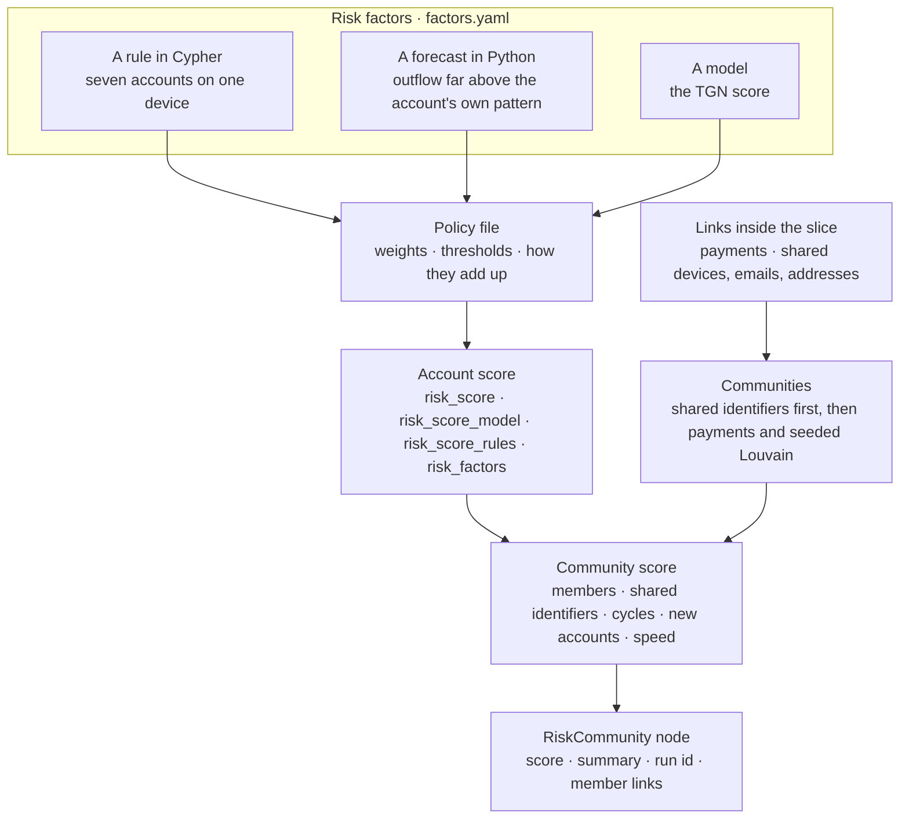

# 04 · Risk scores

Every account gets a score. Every community gets a score. Both are built from risk factors that anyone can add
to a file.



## Three levels

| Level | What it is | Where it lands in Aura |
|---|---|---|
| Risk factor | One reason, scored 0 to 1, with its evidence. A Cypher rule, a Python function or a model produces it | Inside the evidence, not as its own property |
| Account score | The factors combined by the policy file as a noisy-or: a factor that does not fire changes nothing, and a new one can only add. Every part stays visible | `risk_score`, `risk_score_model`, `risk_score_rules` and `risk_factors` on the Account |
| Community score | Built from the members and the shape of the group: how many members score high, the identifiers they share, money cycling inside the group, the share of new accounts, how fast money moves through | A `RiskCommunity` node with its score and summary, linked to its members |

## Adding a factor

A factor is one entry in `factors/factors.yaml`. The file is versioned and checked against a schema.

```yaml
- id: shared_device_5plus
  name: Five or more accounts on one device
  kind: cypher
  query: shared_device.cypher
  threshold: 5
  weight: 0.20
- id: new_accounts_shared_identifier
  name: New accounts sharing an identifier
  kind: cypher
  query: new_accounts_shared_identifier.cypher
  threshold: 3
  weight: 0.65
- id: in_and_out_within_a_day
  name: Money in and out of similar size within a day
  kind: cypher
  query: in_and_out_within_a_day.cypher
  threshold: 3
  weight: 0.65
- id: just_under_threshold
  name: Payments just under 10,000
  kind: cypher
  query: just_under_threshold.cypher
  threshold: 3
  weight: 0.65
- id: fan_in_new_accounts
  name: Fan-in from new accounts
  kind: cypher
  query: fan_in_new_accounts.cypher
  threshold: 5
  weight: 0.20
- id: velocity_anomaly
  name: Outflow far above the account's own forecast
  kind: python
  function: lab.scoring.velocity:score    # statsforecast
  weight: 0.05
- id: tgn
  name: Temporal model score
  kind: model
  source: examples/tgn
  weight: 0.05
```

- **Add an entry, re-run the recipe, and the new factor is in every score and every summary. No code change.**
- **The weights and thresholds that ship are set for the demo data. On real data, the team that owns the review sets them.**
- The MVP ships five rule factors, the velocity forecast and the TGN score. The entries above are the shipped file's,
  each with a `description` left out here.

## How the factors combine

`factors/policy.yaml` says `combine: noisy_or`. **A factor's weight is how much it alone can say, in [0, 1], and the
score is `1 - Π(1 - wᵢ·sᵢ)` over the factors.** `risk_score_rules` is that over the Cypher and Python factors,
`risk_score_model` over the model factors, and `risk_score` over all of them.

- **A factor that does not fire, was skipped or failed changes nothing, and a new factor can only add.** Two
  independent signals add up. The factors are taken as independent, so two that measure the same thing count twice.
- **A weight outside [0, 1] is an error that names the factor.** It is never clipped.
- **An account alerts at or above `alert_threshold`, 0.6 as shipped.** The shipped weights are three tiers: 0.65 for
  the rules that alone are enough (new accounts sharing an identifier, money in and out within a day, payments just
  under 10,000), 0.20 for the rules that only support (a shared device is also a family's laptop; fan-in from new
  accounts is rare), and 0.05 for the velocity forecast and the TGN score, which did not separate planted accounts
  from the rest on the seed (run `run-20261113T082716Z-52f819`). The supporting and unproven factors together cannot reach 0.6.
- **A recipe can choose its factors.** `factors` in the recipe lists factor ids; unset means every factor in the file.
  A factor it does not list is reported `not chosen`, does not run, and counts nothing. An id the file does not have
  is an error that names it.
- `combine: weighted_mean` is still available. There a factor that did not fire counts 0 and keeps its weight in the
  divisor, so adding a factor lowers every score by its share, and the threshold must be set again.
- Precision and recall of the alerts on the seed are on the measured page. To measure.

## Communities

Inside each slice the lab groups accounts in three steps (decisions 42 and 44), and NetworkX does the last.

- **Shared identifiers first.** Accounts joined by a device, an email or an address that at most `LAB_SHARED_MAX` accounts
  of the slice use are linked. Each connected component of at least the policy's `community.min_size` accounts is a
  community as it stands. A planted ring on one device is one community of its members, whatever else they pay. An
  identifier used by more accounts than that links none, and a component under `min_size` goes on to the next step.
- **Then fast money, among the accounts left** (decision 44). Two accounts the `in_and_out_within_a_day` factor fired
  on are linked by a payment the factor matched for either of them. Each connected component of at least `min_size`
  accounts is a community as it stands: a chain that forwards money hop by hop within a day, which shares no
  identifier and which Louvain would merge into a big payment group.
- **Then payments, among the accounts still left.** A payment links two accounts once, either way. Connected components come
  first, and Louvain runs only on the big pieces (more than `LAB_COMPONENT_MIN` accounts). **Louvain is seeded, so a
  re-run gives the same groups.** Louvain never sees an identifier community, because maximising modularity merges small
  clusters inside big graphs (the resolution limit), and fraud rings are small clusters.
- Each community is tagged by how it formed, `identifier`, `flow` or `payment`: the `formed` column of
  `communities.parquet`, and `formed_by_identifier` (1 or 0) among the `score_parts`. It is not a staged column and not a part of the score. The
  measured page reports ring recall for each kind. To measure.
- On the seed slice (run `run-20261113T082716Z-52f819`, 6,546 accounts), the first communities came out as 29 with the
  largest at 758 accounts and a median of 112. Grouped by identifier first they come out as 65 (45 by identifier, 20 by
  payment) with the largest at 651 and a median of 6. With the fast-money step, 7 more come out by flow. The rest of
  the pass-through rings had members outside the search slice, so their chains were cut before grouping. The
  measured page says how many rings of each kind come out whole.
- Community keys are `sha1(run_id | lowest member key)`. A later run makes new communities and leaves the old
  ones as history.
- Whole-graph communities with GDS Leiden on Aura Graph Analytics are release 1.1.

The community score's five parts are `member_risk` (the policy's `community.member_risk_share` mixes the share of members
at the alert threshold with their mean score), `shared_identifiers`, `cycles`, `new_accounts` and `speed`.

- **The parts combine as a noisy-or too** (decision 45): `community.combine: noisy_or` in the policy file. A part at 0
  changes nothing, so a ring that shows one shape strongly is not pulled down by the shapes it lacks.
- **The shipped weights are two tiers.** 0.65 for `member_risk` and 0.20 for each shape. Members who alert reach 0.6 only
  with one more shape, and the four shapes without alerting members reach at most 0.59. They are set for the demo data.
- `combine: weighted_mean` is still available for communities, as it is for accounts.

Three of the parts use the shared definitions in `lab/scoring/signals.py`, which the first pass's summary phrases and the
evidence use too:

- **Cycles are time-respecting.** A cycle is a loop of at most `LAB_CYCLE_MAX_LENGTH` accounts where each pays the next and
  each payment comes after the one before it. A loop paid in the wrong order is not money that came back. Cycles are
  counted up to `LAB_CYCLE_COUNT_CAP` per community.
- **Money in and out within a day is the factor's.** The `speed` part and the summary phrase run
  `factors/in_and_out_within_a_day.cypher` with the factor's threshold (similar amounts within 24 hours). There is no
  second definition.
- **New accounts** are those opened within `LAB_NEW_ACCOUNT_DAYS` of the newest payment.

## The reviewer's decision

Results has three buttons on every account and every community: confirmed, false positive, needs more.

- **The decision goes back to Aura with the push as `risk_disposition`, with who and when.**
- In 1.2 the next training run uses those decisions as labels, and false positives point at the factor to tune.

## Words on this page

| Word | Means |
|---|---|
| policy file | The rules for combining factors into an account score |
| modularity | What Louvain maximises: more links inside groups than between them |
| resolution | Louvain's knob for how small a group can be |
| look-alike | A legitimate pattern the generator plants so that scores are not perfect: a family on one laptop, a payroll account, a landlord |

## Where it lives

`factors/` for the file and its queries, `lab/scoring/` for the policy, the communities and the community score.
