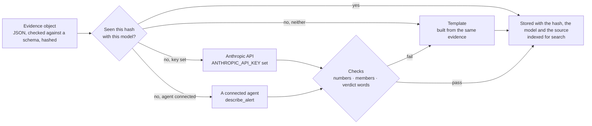

# 05 · Summaries

For the top communities, 20 by default, and the top alerts, 50 by default, a language model writes why they
could be risky. It reads one checked evidence object and nothing else.

## The evidence object

One per community and one per alert. Checked against a JSON schema and hashed with SHA-256 before anything reads
it. It holds:

- the member count, the score and its parts
- the identifiers members share, and how many share each one
- money in, money out, cycles found, and the time span
- the risk factors that fired, with counts and evidence ids
- the top members by score, by key only
- how the community compares to the rest of the slice

**Evidence carries keys and totals. Never names.**

## The summary

120 words or less, in three parts: what the evidence shows, why that pattern could mean risk, and the innocent
explanation to rule out, such as a family sharing a laptop or a payroll account paying many people.

- **It describes patterns, not people.**
- **Every number in the summary must appear in the evidence.**
- **Every account it names must be a member.**
- **Verdict words fail the check. "Fraudster" and "guilty" are out. "Could indicate" is in.**
- **Any failed check means the community gets the template, built from the same evidence.**

## Who writes it

| If | Then |
|---|---|
| `ANTHROPIC_API_KEY` is set | The lab calls the Anthropic API directly. Claude Sonnet 5.5 by default; `LAB_MODEL` in `.env` changes it |
| An agent is connected | The agent writes through the lab's `describe_alert` tool. The same checks apply |
| Neither | Every community and alert gets the template |

- **Evidence leaves the container only when the key is set.**
- Each summary is stored with its evidence hash, the model and the source: API, agent or template.
- The cache key is the evidence hash plus the model. A re-run with the same evidence makes no new call.
- About a thousand tokens of evidence in and 200 at most out, per summary. Cost per community is to measure.

## Where summaries go

Into Relate's full-text index, beside the account summaries from the first pass ([02](02-the-slice.md)). Each
community also gets an embedding, the average of its members'. "Communities like this one" on Results is one
hybrid search over both.

## Where it lives

`lab/summaries/`: the schema, the hasher, the three writers, the checks, the cache. Planned.
