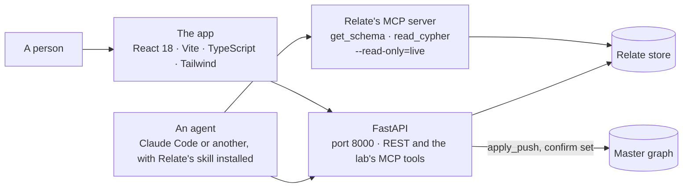

# 06 · The app and the agent

Two ways in. People use the app. Agents read through Relate's own MCP server and act through the lab's tools.

## The rules for every screen

- **One decision per screen.**
- **A default in every field.**
- **An estimate before anything slow runs.**
- **A "show code" button with the recipe and the Python behind what the screen just did.**

## The screens

| Screen | What you do there | When |
|---|---|---|
| Connect | Paste an Aura URI and password, or pick the bundled Neo4j. The lab tests it and says which pull route it will use | MVP |
| Slice | By labels, types and a time window; by Cypher; or by search with `k` and `h`. See the hits, the size and the memory before anything moves | MVP |
| Models | Pick models and risk factors: TGN, Node2Vec, the rule factors, the velocity forecast. Read each one's code or YAML. Set weights and thresholds | MVP |
| Run | One bar per step with live counts. A failed step says what failed and offers to resume | MVP |
| Results | Two tabs, accounts and communities. Open a community: its members on a graph, its score and the parts of it, the summary with its source, the evidence, and "communities like this one". Confirmed, false positive or needs more on every row | MVP |
| Review and push | The dry-run plan and the lab's delta, grouped by kind, with one confirm button | MVP |
| Timeline | A slider that re-queries Relate "as of t" on the server | MVP. The in-browser version is 1.1 |
| History | Every run with its recipe and counts. Pick two to compare | Later |

The test the app is held to: someone who has never seen it gets from `docker compose up` to a reviewed push on
the seed data in 15 minutes. To measure.

## The agent

Install Relate's skill with `relate skill install`. Connect the agent to two MCP servers: Relate's, serving the
lab's store read-only and following the lab's writes, and the lab's. The two long tools queue their work and
answer at once; the agent polls `run_status` (decision 38).

| The lab's tool | Does |
|---|---|
| `egress` | Queue a fresh run: pull a slice from the master graph into a new store, then its first pass. Answers at once with the run id |
| `run_status` | The run's manifest: each step's status, counts and note. An agent polls it after `egress` and `score` |
| `search_slice` | Hybrid search plus hops; returns the hits, the size and the memory |
| `score` | Queue the models, factors, policy, communities and summaries on the slice. Answers at once |
| `preview_push` | The dry-run plan plus the delta |
| `apply_push` | Push. Fails without `confirm=true`, and without a review newer than the last thing staged (decision 37) |
| `explain_alert` | The evidence object for an account or a community |
| `describe_alert` | Store a summary for an account or a community, after the checks |
| `graph_diff` | What changed between two runs |

- **The agent reads the subgraph and the evidence through Relate's `read_cypher`. It never writes to the store directly.**
- **`apply_push` with confirm set is the only tool that writes to the master graph.**
- **Whatever the agent writes through `describe_alert` passes the same checks as the API's summaries.**

## Where it lives

`app/` for the screens, `lab/api/` for the routes and the MCP tools.
