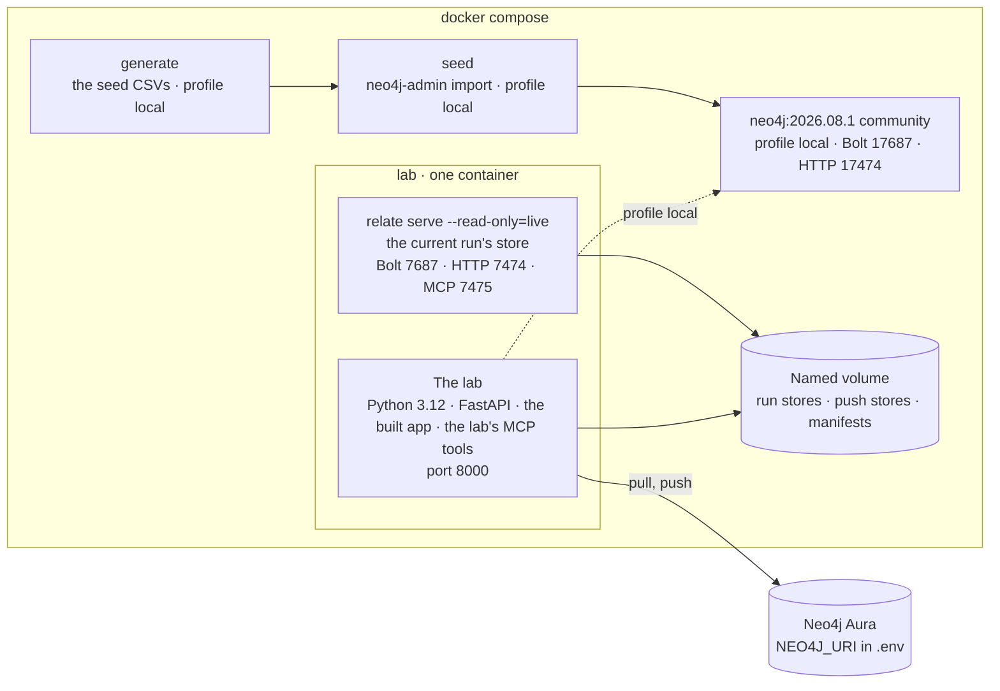

# 07 · What runs where

One image for the lab, which also serves the current run's store through Relate, and an optional bundled Neo4j
for anyone without an Aura account.



## Services

| Service | What it is | Ports and profiles |
|---|---|---|
| `lab` | Python 3.12, FastAPI, Relate's library and the checked `relate` binary, PyTorch 2.12 and PyG on CPU, the built React app, the lab's MCP server. It runs one `relate serve --read-only=live` for the current run's store and restarts it when a new run starts | 8000, plus 7687, 7474 and 7475 for Relate. All published on 127.0.0.1 only |
| `generate` | The lab image running `python -m generator` once: the import CSVs, `ground_truth.parquet` and `generator.json`, written to a volume. `LAB_SEED_SIZE` picks `small` or `1m`, `LAB_SEED` the seed | Profile `local` |
| `seed` | `generator/import.sh`: `neo4j-admin database import full` of those CSVs into the Neo4j data volume, once, before Neo4j first starts. A marker file on the volume makes every later start a no-op | Profile `local` |
| `neo4j` | `neo4j:2026.08.1` community with the seed | 17687, 17474. Profile `local` |
| `neo4j-test` | A second `neo4j:2026.08.1` for live tests only, in memory; the tests wipe it | 27697, 27484. Profile `test` |
| `seed-schema` | `cypher-shell -f generator/schema.cypher` once the bundled Neo4j is healthy: a uniqueness constraint on each node key, `IF NOT EXISTS` | Profile `local` |

Volumes are named, not bind mounts. No Relate server image is published, so the lab carries the binary itself
(decision 21 on [08](08-decisions.md)).

## Two ways to run

```
cp .env.example .env     # NEO4J_URI, NEO4J_USERNAME, NEO4J_PASSWORD, NEO4J_DATABASE
docker compose up        # the main path: your Aura instance
```

```
docker compose --profile local up     # plus the bundled Neo4j and the seed
```

## Settings

Every setting lives in `lab/settings.py` and `.env.example`. The judgment numbers are settings too, so none sits
inline in code.

| `.env` | Default | What it does |
|---|---|---|
| `NEO4J_URI` · `NEO4J_USERNAME` · `NEO4J_PASSWORD` · `NEO4J_DATABASE` | The bundled Neo4j | The master graph, for the Bolt driver |
| `NEO4J_QUERY_URI` | Derived from `NEO4J_URI` | The `http(s)` Query API that `relate pull` and `relate push` use. Set it when Neo4j's ports are not the defaults |
| `ANTHROPIC_API_KEY` | Unset | Summaries through the Anthropic API. Unset, the agent or the template writes them ([05](05-summaries.md)) |
| `LAB_MODEL` | `claude-sonnet-5-5` | The model behind summaries |
| `LAB_SEARCH_K` · `LAB_SEARCH_HOPS` | 50 · 1 | Defaults for a search slice; a hop is one account-to-account step (decision 41) |
| `LAB_SLICE_CAP` | 200,000 nodes | The size a search slice refuses to pass |
| `LAB_PUSH_BATCH` | 5,000 | Rows per push batch |
| `LAB_LOAD_START_ROWS` | 20,000 | Where the loader starts before it raises or backs off |
| `LAB_SUMMARY_COMMUNITIES` · `LAB_SUMMARY_ALERTS` · `LAB_SUMMARY_WORDS` | 20 · 50 · 120 | How many summaries, and how long |
| `LAB_LOUVAIN_RESOLUTION` · `LAB_COMPONENT_MIN` | 1.0 · 30 | Louvain's resolution, and the component size above which Louvain runs |
| `LAB_WEIGHT_DEVICE` · `LAB_WEIGHT_EMAIL` · `LAB_WEIGHT_ADDRESS` · `LAB_WEIGHT_PHONE` · `LAB_WEIGHT_OTHER` · `LAB_WEIGHT_PAYMENT` | 3.0 · 2.0 · 1.5 · 2.0 · 1.0 · 1.0 | Link weights for communities |
| `LAB_SEED` | 42 | The random seed for the generator, Node2Vec and Louvain |
| `LAB_EMBEDDING_DIM` | 64 | Node2Vec's embedding size, and the vector indexes' dimensions |
| `LAB_SHARED_MAX` | 50 | An identifier shared by more accounts than this links none of them for communities, and is counted |
| `LAB_KEY_BATCH` | 500 | Account keys per Relate statement. Relate 1.0.1's `IN $keys` slows with the square of the list |
| `LAB_NEW_ACCOUNT_DAYS` · `LAB_ROUND_THRESHOLD` · `LAB_JUST_UNDER` | 60 · 10,000 · 0.05 | The account summary's phrases: "new account" and "payments just under 10,000" (the share below the round number). "Money in and out within a day" is the factor's own query, with the factor's threshold |
| `LAB_CYCLE_MAX_LENGTH` · `LAB_CYCLE_COUNT_CAP` | 6 · 1,000 | The longest payment cycle looked for, in accounts, and the most cycles counted per community |
| `LAB_VELOCITY_HOLDOUT_DAYS` · `LAB_VELOCITY_MIN_HISTORY_DAYS` · `LAB_VELOCITY_MIN_ACTIVE_DAYS` | 14 · 28 · 3 | The velocity factor: the recent days held out, and the history an account needs to be scored |
| `LAB_SUMMARY_SMALL_GROUP` | 8 | Up to this many members, money between them reads as a household in the template; more reads as a club or a market |
| `LAB_EVIDENCE_TOP_MEMBERS` · `LAB_EVIDENCE_MAX_IDENTIFIERS` · `LAB_EVIDENCE_MAX_IDS` | 5 · 10 · 10 | What an evidence object lists: the top members, the shared identifiers, the evidence ids per factor |
| `LAB_DELTA_SAMPLE` | 1,000 | Accounts sampled from the master graph for the review's delta |
| `LAB_DATA_DIR` | `data` | Run stores, push stores and manifests |
| `LAB_APP_DIST` | `app/dist` | The built app the lab serves at `/`; `/srv/app/dist` in the image |
| `LAB_PORT` · `LAB_RELATE_BOLT_PORT` · `LAB_RELATE_HTTP_PORT` · `LAB_RELATE_MCP_PORT` | 8000 · 7687 · 7474 · 7475 | Host ports for the lab and Relate |
| `LAB_NEO4J_BOLT_PORT` · `LAB_NEO4J_HTTP_PORT` | 17687 · 17474 | Host ports for the bundled Neo4j |
| `DO_NOT_TRACK` | `1` | Relate's telemetry switch. Set in every container and every call |

## Limits we build around

- Relate's `LOAD CSV` reads files of 8 MiB or less. The lab loads through the library instead.
- One commit cannot exceed 64 MiB. A bigger one is refused whole with a `DataError`. Checked in wave 0.
- Relate uses about 502 bytes per node and 404 bytes per relationship on disk, and a served store runs at 1.2 to
  1.5 times that in memory. From the docs.
- Relate's WebAssembly build has no Arrow or Parquet, so the in-browser timeline waits for 1.1.
- `relate push` 1.0.1 fails on zoned datetime properties, so the push store carries timestamps as strings.
- Aura Free's limits differ between Neo4j's own pages: 200,000 nodes and 400,000 relationships in the docs,
  50,000 and 175,000 on the product page. The small seed fits the smaller one.

## To measure

| What | Expectation | Status |
|---|---|---|
| Memory at 1M relationships | Relate about 0.6 to 0.8 GB running, PyG training about 0.5 GB, so an 8 GB laptop | To measure in wave 6 |
| `relate pull` at 100k and 1M relationships | No documented figure | To measure in wave 6 |
| Image size with CPU PyTorch | Large | To measure in wave 6, then into the README |

## Where it lives

`compose.yaml`, `Dockerfile`, `.env.example`, `lab/settings.py`.
