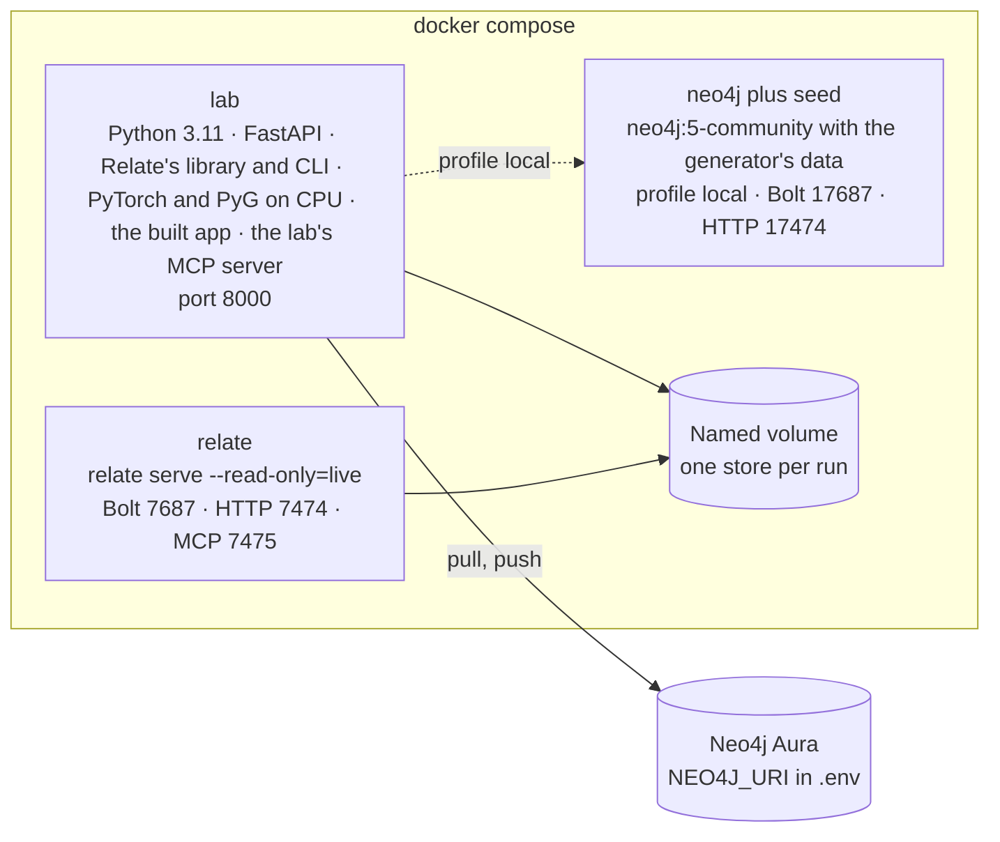

# 07 · What runs where

One image for the lab, Relate's own image serving beside it, and an optional bundled Neo4j for anyone without an
Aura account.



## Services

| Service | What it is | Ports and profiles |
|---|---|---|
| `lab` | Python 3.11, FastAPI, Relate's library and CLI, PyTorch and PyG on CPU, the built React app, the lab's MCP server. One image | 8000. Profile `gpu` adds the NVIDIA device |
| `relate` | Relate's own image, serving the lab's store with `--read-only=live` over Bolt, HTTP and MCP | 7687, 7474, 7475 |
| `neo4j` plus `seed` | A bundled `neo4j:5-community` with the generator's data imported before first start. Optional | 17687, 17474. Profile `local` |

Volumes are named, not bind mounts. Relate's image is scratch, with no shell, running as UID 1000.

## Two ways to run

```
cp .env.example .env     # NEO4J_URI, NEO4J_USERNAME, NEO4J_PASSWORD, NEO4J_DATABASE
docker compose up        # the main path: your Aura instance
```

```
docker compose --profile local up     # plus the bundled Neo4j and the seed
```

## Settings

| `.env` | Values | What it does |
|---|---|---|
| `NEO4J_URI` · `NEO4J_USERNAME` · `NEO4J_PASSWORD` · `NEO4J_DATABASE` | Your Aura instance, or the bundled Neo4j | What `relate pull` and `relate push` read and write. The same names Relate's CLI reads |
| `ANTHROPIC_API_KEY` | A key | Summaries through the Anthropic API. Unset, the agent or the template writes them ([05](05-summaries.md)) |
| `LAB_MODEL` | A model id | The model behind summaries. Claude Sonnet 5.5 when unset |
| `LAB_SEARCH_K` · `LAB_SEARCH_HOPS` | Numbers | Defaults for the Slice screen: 50 and 2 |
| `LAB_SLICE_CAP` | A node count | The size a search slice refuses to pass |
| `DO_NOT_TRACK` | `1` | Relate's telemetry switch. Set in every container |

## Limits we build around

- Relate's `LOAD CSV` reads files of 8 MiB or less. The lab loads through the library instead.
- One commit's write-ahead record cannot exceed 64 MiB. A bigger one is refused whole.
- Relate uses about 502 bytes per node and 404 bytes per relationship on disk, and a served store runs at 1.2 to
  1.5 times that in memory. From the docs.
- Relate's WebAssembly build has no Arrow or Parquet, so the in-browser timeline waits for 1.1.
- `execute_arrow()` returns results as Arrow. It does not take Arrow in.
- Aura Free's limits differ between Neo4j's own pages: 200,000 nodes and 400,000 relationships in the docs,
  50,000 and 175,000 on the product page. The small seed fits the smaller one.

## To measure

| What | Expectation | Status |
|---|---|---|
| Memory at 1M relationships | Relate about 0.6 to 0.8 GB running, PyG training about 0.5 GB, so an 8 GB laptop | To measure |
| `relate pull` at 100k and 1M relationships | No documented figure | Week one |
| `relate serve --read-only=live` seeing the lab's commits | From the docs | Week one. Fallback: restart after each write |
| Image size with CPU PyTorch | Large | To measure, then into the README |

## Where it lives

`compose.yaml`, `Dockerfile`, `.env.example`. Planned.
