# A fraud ring, end to end

subgraph-lab walkthrough · run `run-20261116T045118Z-4953ae` · 15 November 2026 · synthetic data

**What you are looking at.** subgraph-lab pulls part of a Neo4j graph into Relate, Neo4j's embedded graph database, hands it to open-source graph models, scores accounts and communities, writes down why each community could be risky, and pushes the results back to Neo4j after a person has reviewed a dry run.

This walkthrough follows one planted fraud ring through every screen: from the graph, to a score and a written reason, to a reviewer's decision, and back into Neo4j. Every screenshot is from one real run of the lab on its demo data.

The demo bank is synthetic. Its generator plants three kinds of fraud ring (mule rings, structuring, pass-through chains) plus honest look-alikes that should not score high: families sharing a laptop, payroll accounts, landlords. Because it writes down who is in every ring, anyone can check what the lab finds.

The same page with the images embedded, for sending or reading offline: [walkthrough.html](walkthrough.html). The screenshots came from [walk.py](walk.py) driving the app, and this page from [build_walkthrough.py](build_walkthrough.py).

The same job done by an agent through the two MCP servers, from its own log: [agent.md](agent.md).

## Inspect it yourself

The store this run pulled and enriched is in this folder as one file, `store.rl` (9.8 MB): the slice, every account's embedding and summary, the 172 communities with their scores and summaries, and the 11 indexes. Relate wrote it with `relate clone`. With the `relate` CLI installed ([relatedb.ai/docs](https://relatedb.ai/docs/), or `uv run python tools/install_relate.py` from the repo root), run these from this folder. The output under each is what the committed file returns. Every query opens it read-only, so the file stays as committed. The `relate` CLI sends anonymous usage metrics by default; set `DO_NOT_TRACK=1`, or run `relate telemetry off` once, to turn that off.

**The store, without opening it.**

```
relate info -d store.rl
```

```
layout: .rl bundle
codec: parquet
nodes (at checkpoint LSN 93): 28849
relationships (at checkpoint LSN 93): 37612
indexes: 11
  account_embedding: :Account(risk_embedding)
  account_summary: :Account(lab_summary)
  community_embedding: :RiskCommunity(embedding)
  community_summary: :RiskCommunity(summary)
  ...
```

**The riskiest communities, with the reason the lab wrote for each.**

```
relate query -d store.rl --read-only --mode table "MATCH (c:RiskCommunity) RETURN c.size AS members, round(c.score,2) AS score, left(c.summary, 90) AS summary ORDER BY c.score DESC LIMIT 5"
```

```
+---------+-------+----------------------------------------------------------------------------------------------+
| members | score | summary                                                                                      |
+---------+-------+----------------------------------------------------------------------------------------------+
| 5       | 0.84  | "This community has 5 accounts and scores 0.84, ranking 1 of 172 communities in the slice; " |
| 6       | 0.77  | "This community has 6 accounts and scores 0.77, ranking 2 of 172 communities in the slice; " |
| 5       | 0.75  | "This community has 5 accounts and scores 0.75, ranking 3 of 172 communities in the slice; " |
| 7       | 0.74  | "This community has 7 accounts and scores 0.74, ranking 4 of 172 communities in the slice; " |
| 7       | 0.72  | "This community has 7 accounts and scores 0.72, ranking 5 of 172 communities in the slice; " |
+---------+-------+----------------------------------------------------------------------------------------------+
```

**The ring's members and what they share. The connected context is the evidence.**

```
relate query -d store.rl --read-only --mode table "MATCH (c:RiskCommunity {community_key:'6cb5be18371a49ace1bdea774b6878ef87612fea'})<-[:IN_RISK_COMMUNITY]-(a:Account)-[:USES_DEVICE|HAS_ADDRESS]->(i) RETURN a.account_id AS account, labels(i)[0] AS shares, coalesce(i.device_id, i.address_id) AS id ORDER BY account, shares"
```

```
+------------+-----------+-------------+
| account    | shares    | id          |
+------------+-----------+-------------+
| "A0000897" | "Address" | "AD0000896" |
| "A0000897" | "Device"  | "D0000896"  |
| "A0001287" | "Address" | "AD0000896" |
| "A0001287" | "Device"  | "D0000896"  |
| "A0001723" | "Address" | "AD0000896" |
| "A0001723" | "Device"  | "D0000896"  |
| "A0001818" | "Address" | "AD0000896" |
| "A0001818" | "Device"  | "D0000896"  |
| "A0005373" | "Address" | "AD0000896" |
| "A0005373" | "Device"  | "D0000896"  |
+------------+-----------+-------------+
```

**Ask the store in plain words. Full-text search over the account summaries returns the five members.**

```
relate query -d store.rl --read-only --mode table "MATCH (a:Account) SEARCH a IN (FULLTEXT INDEX account_summary FOR 'new accounts sharing one device and address' LIMIT 5) SCORE AS s RETURN a.account_id AS account, round(s, 2) AS score"
```

```
+------------+-------+
| account    | score |
+------------+-------+
| "A0001818" | 5.61  |
| "A0000897" | 5.61  |
| "A0001287" | 5.61  |
| "A0005373" | 5.61  |
| "A0001723" | 5.61  |
+------------+-------+
```

**Communities like the ring, by vector search on the community embeddings.**

```
relate query -d store.rl --read-only --mode table "MATCH (seed:RiskCommunity {community_key:'6cb5be18371a49ace1bdea774b6878ef87612fea'}) MATCH (c:RiskCommunity) SEARCH c IN (VECTOR INDEX community_embedding FOR seed.embedding LIMIT 4) SCORE AS s RETURN c.size AS members, round(c.score,2) AS risk, round(s,3) AS similarity"
```

```
+---------+------+------------+
| members | risk | similarity |
+---------+------+------------+
| 5       | 0.84 | 1.0        |
| 3       | 0.63 | 0.656      |
| 3       | 0.07 | 0.654      |
| 8       | 0.03 | 0.647      |
+---------+------+------------+
```

**Let an agent read it. Relate's own MCP server on the file, read-only, for Claude Desktop or Claude Code.**

```
relate serve --database store.rl --mcp stdio --read-only
```

```
serve: opened the store read-only — no writer lease and never creates the store; every write fails
hint: agents can report Relate friction to its developers — draft it, ask the person, then run 'relate agent-feedback'
serve: MCP (stdio) serving on stdin/stdout (auth: none)
```

## The run, step by step

### 1. Connect to the graph

The lab starts by testing the master graph. Here that is the Neo4j bundled with the lab, holding the demo bank: 10,000 accounts with their devices, emails and addresses, and 120,000 payments. The screen names the route the pull will take: `relate pull`, over Neo4j's Query API.

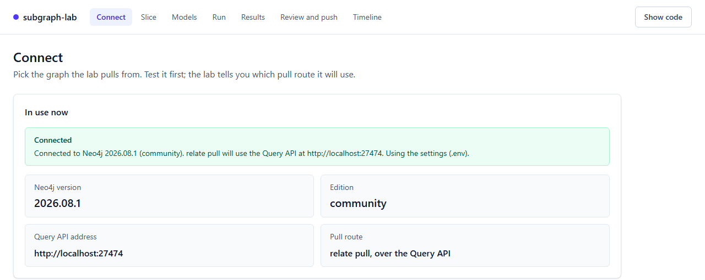

*Connect: the graph in use, its version, and the pull route.*

### 2. Choose the risk factors

Every way of spotting risk is a **risk factor** in one YAML file: five rules in Cypher, a forecast in Python, and a temporal graph model. Tick the ones this run uses. Each weight says how much that factor alone can say about an account.

The rule that matters most for this ring is *new accounts sharing an identifier*. Its code is one click away. It is plain Cypher, and anyone can read it or change it.

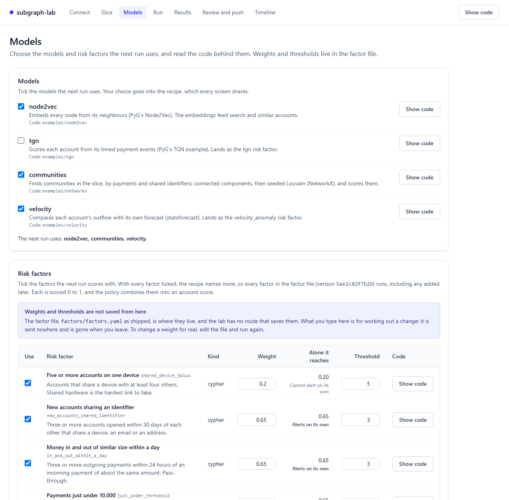

*Models: the factors, their kind and weight. TGN is unticked to keep this run short.*

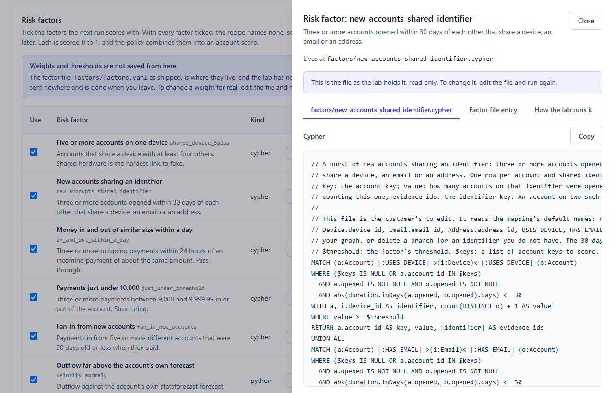

*The rule behind "new accounts sharing an identifier", as the lab runs it.*

### 3. Pick the slice, and see its size first

The slice is the part of the graph the models work on. Here it is every payment since 20 October, with the accounts and identifiers around them. **The lab counts it on the master graph before anything moves**, memory included, so nobody pulls more than they meant to.

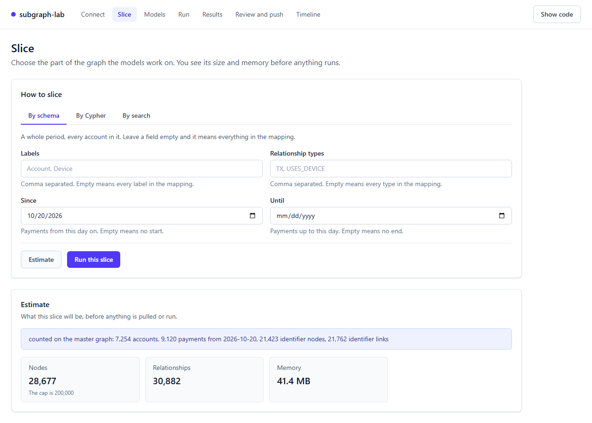

*Slice by schema: the estimate comes first. Then the Run button comes on.*

### 4. Run: pull, learn, score

One click runs the whole recipe. Relate pulls 28,677 nodes and 30,882 relationships into a fresh store in about four seconds. A first pass embeds every node with Node2Vec from PyTorch Geometric and writes a short summary on every account, so the store can be searched by meaning and by words. Then the risk factors score every account, NetworkX finds communities, and each community gets a score and a written summary.

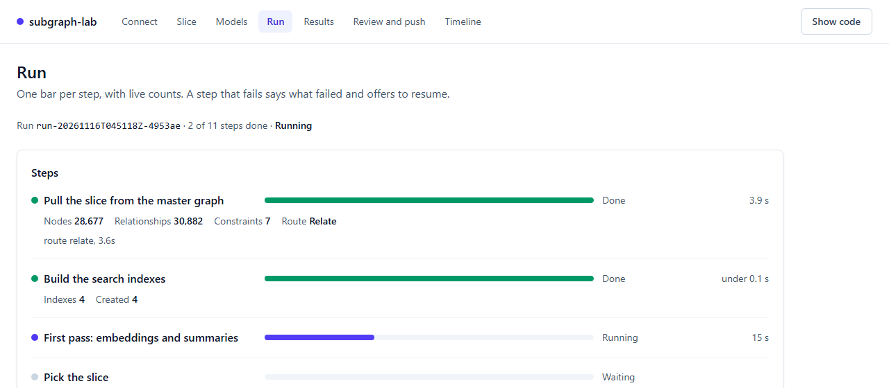

*A few seconds in: the pull done, the first pass running.*

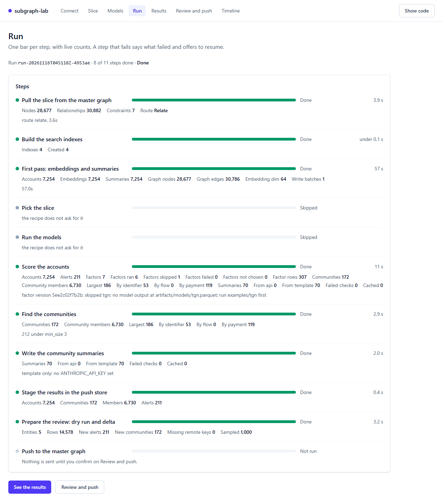

*Every step done. Nothing has touched the master graph yet.*

### 5. The accounts at the top

The highest-scoring accounts score 0.90, and each shows why. Three factors fired on each one: five or more accounts on one device, new accounts sharing an identifier, and money in and out of similar size within a day. The factors combine as a *noisy-or*. A factor that does not fire changes nothing, and each one that does can only add.

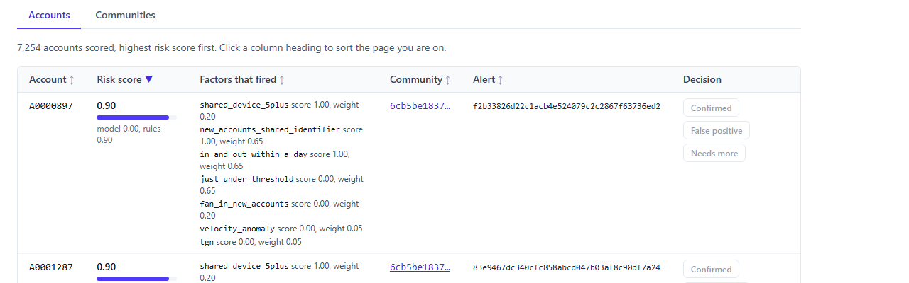

*Results, Accounts: the score, every factor with its score and weight, the community, the alert.*

### 6. The communities at the top

Accounts do not commit fraud alone, so the lab groups them. It links accounts that share a device, an email or an address first, then chains of money forwarded within a day, then payments. Of 172 communities in this slice, the top one has five members and scores 0.84.

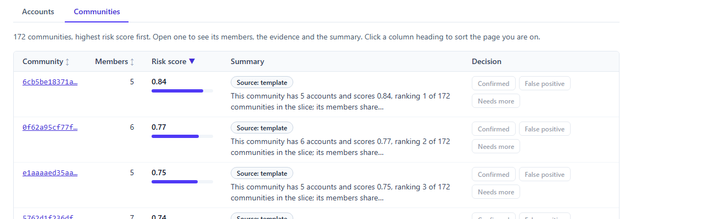

*Results, Communities: highest risk first, each with its summary.*

### 7. Open the ring

The community opens to everything a reviewer needs to judge it.

- **The summary** says what the evidence shows, why that pattern could mean risk, and **the innocent explanation to rule out first**. It is written only from a checked evidence object. This one came from the template, since no API key is set.
- **The score's parts** are shown with the arithmetic, so the 0.84 can be checked by hand.
- **The picture** shows five accounts on one device and one address, paying each other in loops.
- **The evidence** has the shared identifiers, the money in, out and around, 21 payment cycles in ten and a half days, the factors that fired, and how this community compares with the rest.

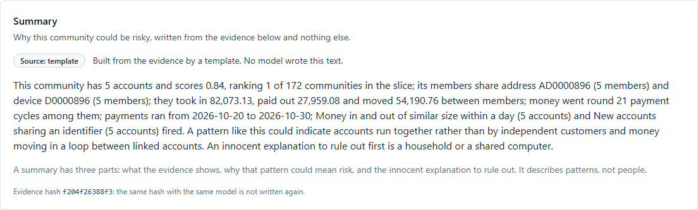

*The summary, with its source and the hash of the evidence it was written from.*

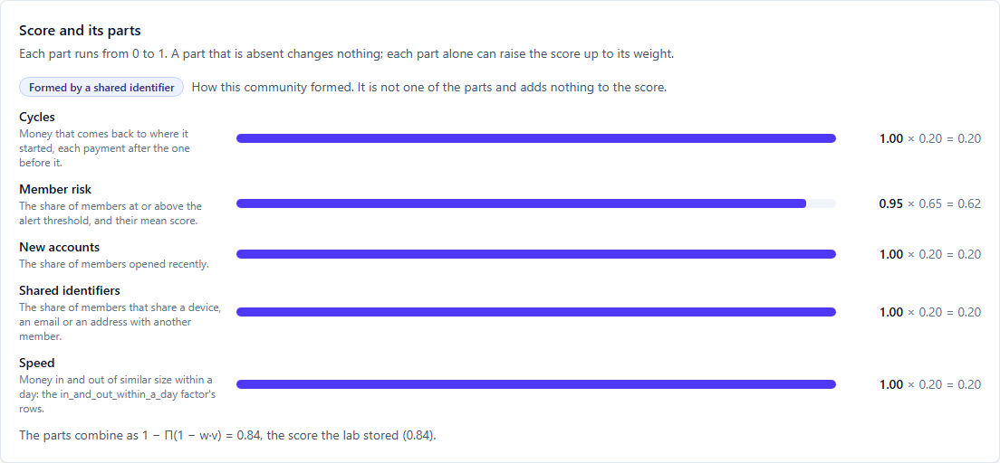

*The score and its parts: 1 − Π(1 − w·v) = 0.84, the score the lab stored.*

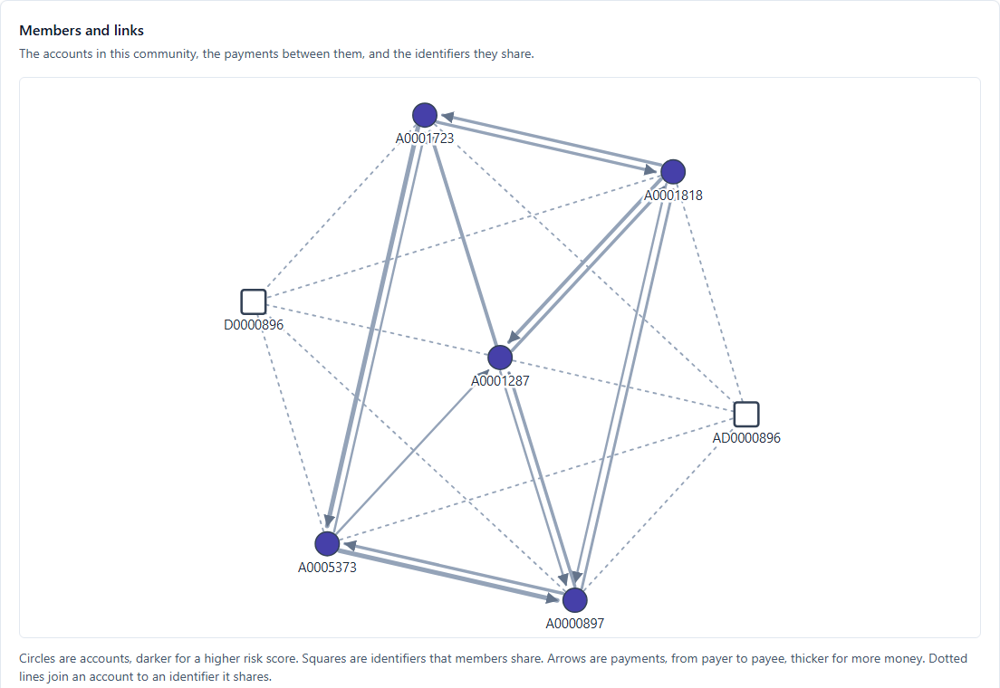

*Members and links: circles are accounts, squares the device and address they share, arrows payments.*

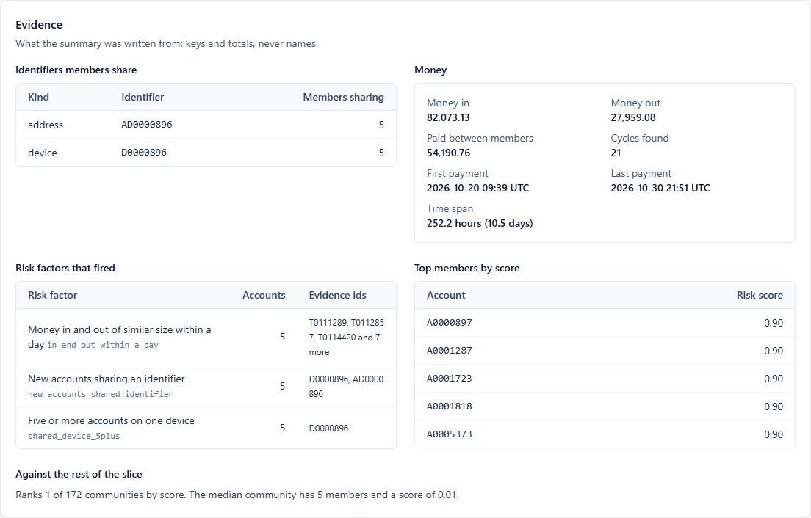

*The evidence: keys and totals, never names.*

### 8. Check it against the truth

> **This is planted ring R0006.** The demo generator plants 60 fraud rings and writes down who is in each. R0006 is a mule ring: five accounts opened within weeks of each other on one device and one address, taking money in from outsiders and cycling it between them.
>
> The lab's top community is **exactly those five accounts, no more and no fewer**. It was not told the answer.

### 9. The reviewer decides

The reviewer marks the community **Confirmed**, with their name. The decision is staged and goes back to Neo4j with the push, with who made it and when. False positive and Needs more work go the same way. A later version learns from them.

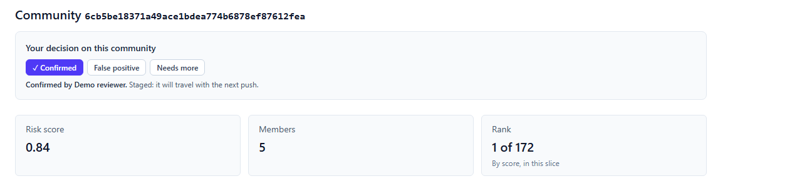

*The decision on this community, staged for the next push.*

### 10. Find more like it

Two ways to find the next one. **Communities like this one** runs one hybrid search over the community summaries and embeddings. **Search** asks the store a question in plain words. Asked for "new accounts sharing one device and address", vector search and full-text search, fused by rank, **put the five members of R0006 at the top of the list**. Each was found by both. The slice around the hits is sized before anything runs: 696 nodes and 1.0 MB.

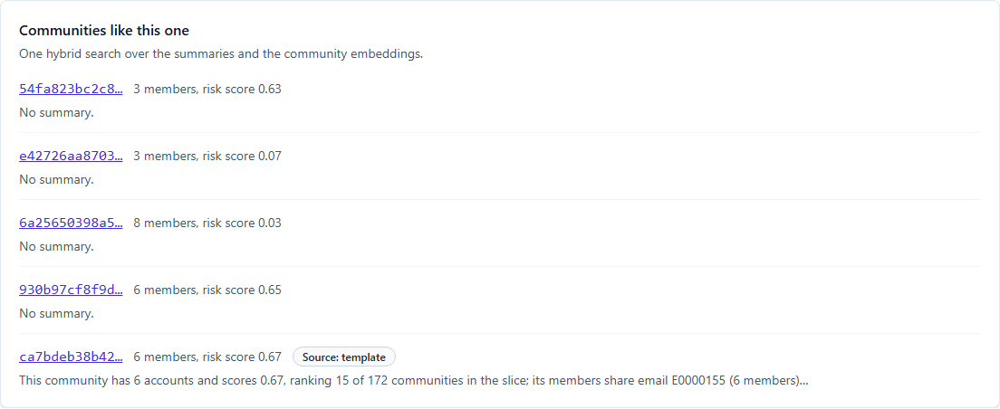

*Communities like this one.*

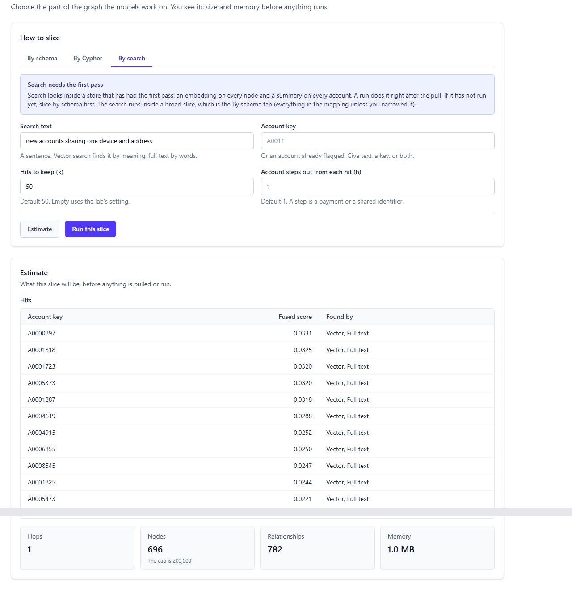

*Slice by search: the top five hits are the ring's members. The size and memory come first.*

### 11. Review the push

Before anything is written, the lab shows two things side by side. One is the plan from Relate's dry run. The other is **the lab's own comparison with the master graph**: 211 new alerts, 172 new communities, scores on 7,254 accounts, one reviewer decision. Nothing is deleted, ever.

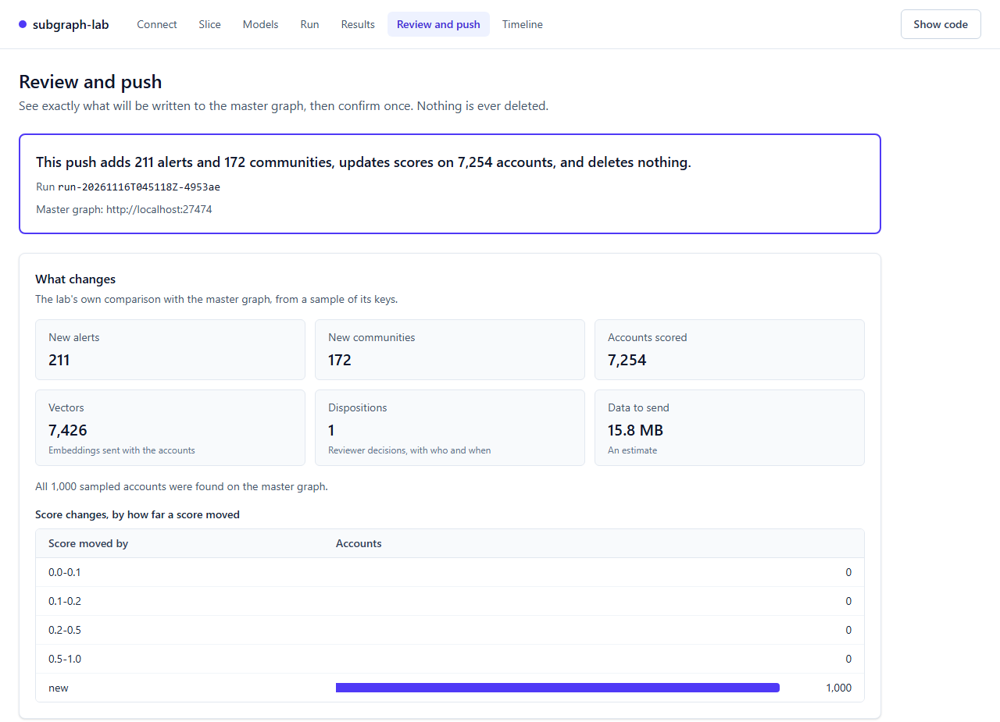

*Review and push: the delta and the plan, before anything is sent.*

### 12. One confirm

The confirm names the graph it will write to and says what will land. It is the only place in the lab that writes to the master graph. An agent working through the lab's tools gets the same gate.

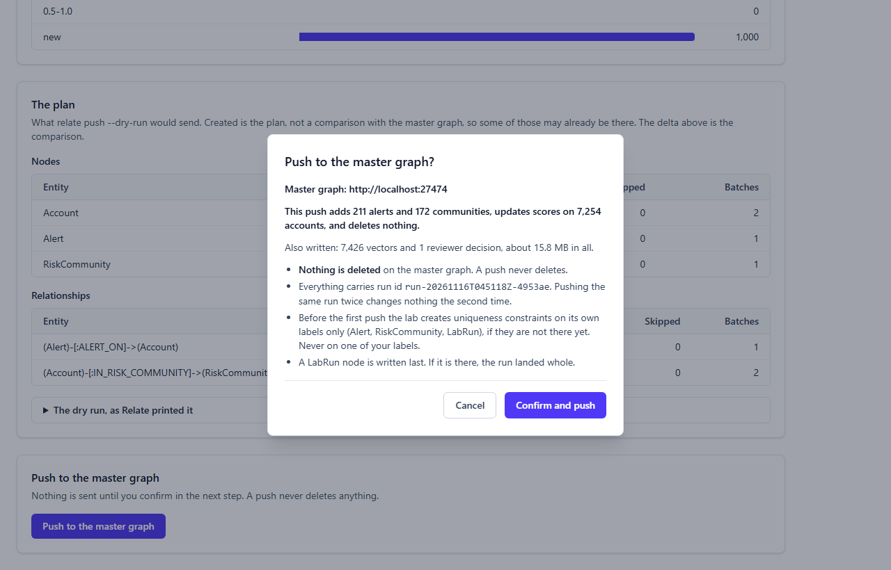

*The one confirm.*

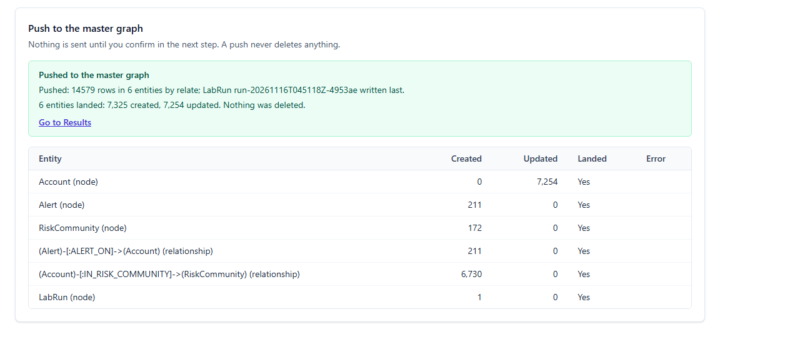

*Pushed. The run marker is written last: if it is there, the whole run landed.*

### 13. Back in Neo4j

In Neo4j Browser, on the master graph: the ring's community node, linked to its five members and to the device and address they share. On the node sit the score, the decision "confirmed" by the reviewer, and the run that wrote it, pulled and pushed by Relate.

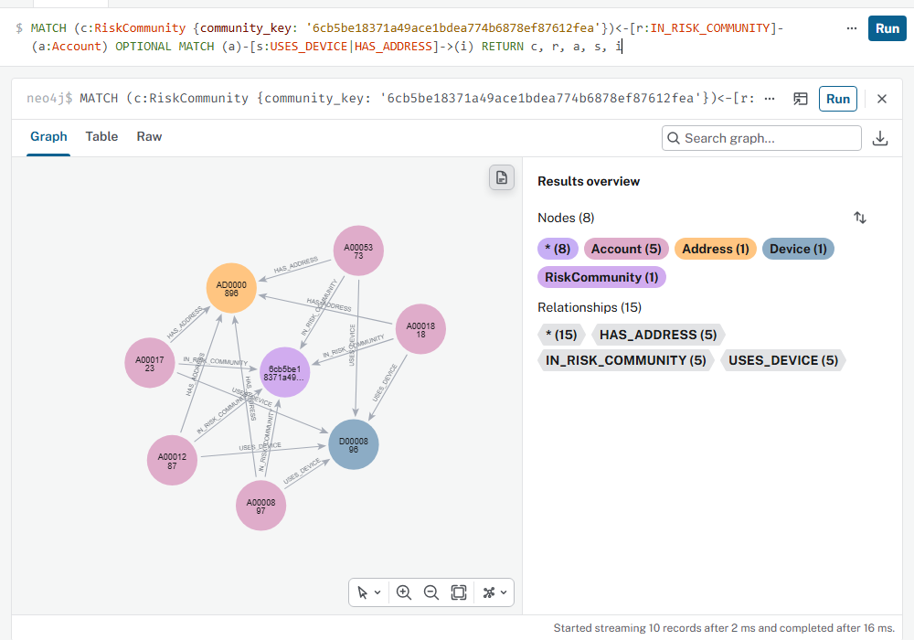

*Neo4j Browser: the RiskCommunity linked to its members, their device and their address.*

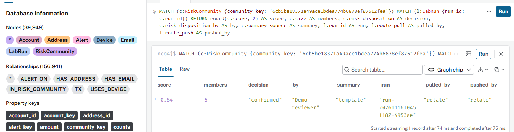

*The score, the reviewer's decision, and the LabRun that put it there.*

## How the whole slice did

R0006 was not a lucky pick. Against the generator's ground truth, for this one run:

| Measure | This slice |
|---|---|
| Accounts scored | 7,254 |
| Alerts, and alerts on a planted ring account | 211, of which 210 |
| Communities scoring 0.6 or more, and those holding planted ring accounts | 39, all 39 |
| Rings with three or more members in the slice, found whole in a community scoring 0.6 or more | 39 of 53 |
| Honest look-alike groups in a community scoring 0.6 or more | 0 of 60 |
| Look-alike accounts that alerted | 1 of 911 |

This slice keeps only payments since 20 October, and 77 percent of the planted accounts in it alerted. Scored over the whole seed, the lab's measured page reports alert recall of 1.00, precision of 0.98, and all 60 planted rings found whole in a high-scoring community.

**What is demo and what is real.** The data is synthetic, and the generator plants exactly the patterns the rules look for, so these numbers say the lab finds what it was built to find, not how it does on real fraud. The weights are set for the demo data. The summaries here came from the template; with an Anthropic API key set, a model writes them from the same checked evidence. The TGN model was left out of this run to keep it short. The pull, the scores, the communities, the review and the push are the real thing, and the push landed on the Neo4j you see in the last step.
