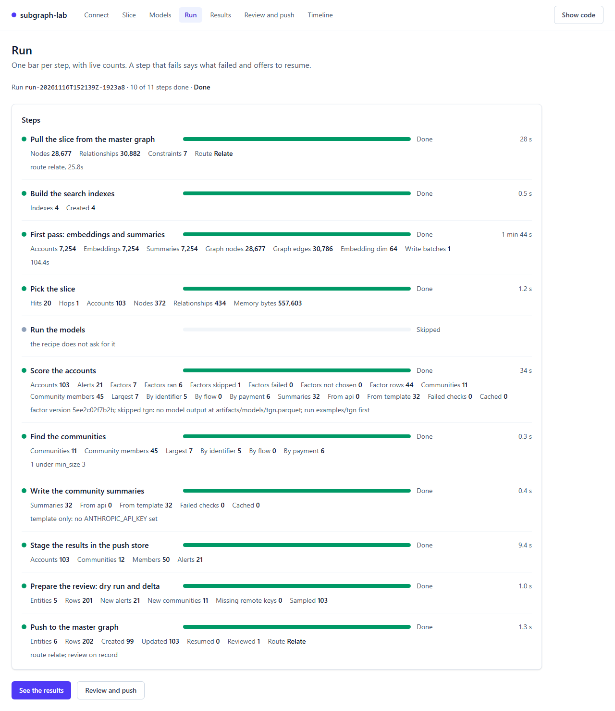
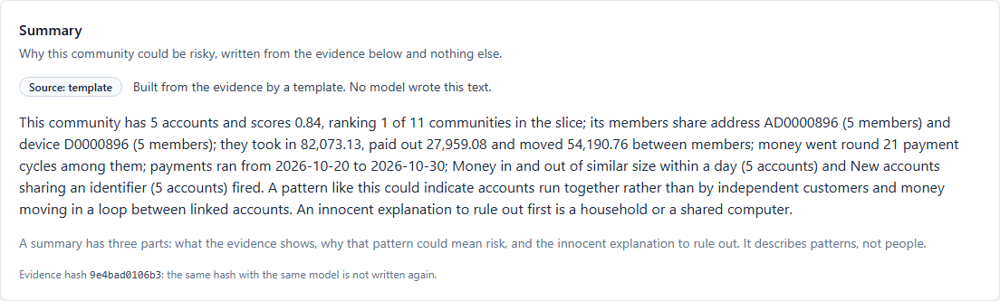

# An agent finds the ring

Gave Claude Code (Sonnet) two MCP servers, the lab's and Relate's, and nothing else. The task, in plain words: find
the riskiest ring among accounts active since 20 October 2026 and explain it. It found R0006, the planted ring a
person finds in [the walkthrough](README.md). On the way it pulled a slice, searched it, scored it, read the
communities through Relate, wrote a summary the lab checked, read the dry run and pushed the results back with a
confirm. 13 turns, 2.8 minutes.

This page is rendered from the session's log, [`agent/session.jsonl`](agent/session.jsonl), by
[`build_agent.py`](build_agent.py). Nobody edits it by hand.

## The guardrails

None of these rely on the prompt. Each is a flag or a check in the lab's code.

- **Two MCP servers, no other tools.** No shell, no files, no web. The flags in `run.py` turn the rest off, and it
  keeps a log only when the session had the two servers' tools and nothing else.
- **Reads go through Relate's MCP server, read-only.** `relate serve --read-only=live` follows the lab's writes and
  refuses any write sent through it.
- **Actions go through the lab's nine tools.** The long ones queue their work and answer at once. `run_status`
  waits for them.
- **One write reaches the master graph: `apply_push` with `confirm` set to the JSON boolean `true`.** A string or a
  number is refused (decision 50). It fails without a `preview_push` newer
  than the last thing staged. That review is Relate's dry run plus the lab's own delta.
- **The agent's summary gets the same checks as the API's.** Every number has to be in the evidence, every member it
  names has to be a member, and no verdict words. A summary that fails is replaced by the template, and the tool
  says why. This one failed on three numbers.

## Run it yourself

With the lab running (`docker compose --profile local up`, or `uv run python -m lab serve`) and Claude Code
installed, from the repo root, in any shell:

```
uv run python demo/agent/run.py      # the prompt is demo/agent/prompt.md; the ports come from .env, as Compose's do
uv run python demo/build_agent.py    # this page, from the new log
```

## The session

Model `claude-sonnet-5-5`. MCP servers: `lab` connected, `relate` connected. Tools the agent had: 11 from the two servers, and nothing else. 13 turns, 2.8 minutes.

The run it made, from the lab's manifest ([`agent/manifest.json`](agent/manifest.json)): `run-20261116T152139Z-1923a8`, pulled by `relate` and pushed by `relate`.

| step | status | counts |
|---|---|---|
| pull | done | nodes 28,677, relationships 30,882, constraints 7 |
| indexes | done | indexes 4, created 4 |
| first_pass | done | accounts 7,254, embeddings 7,254, summaries 7,254 |
| slice | done | hits 20, hops 1, accounts 103 |
| models | skipped |  |
| score | done | accounts 103, alerts 21, factors 7 |
| communities | done | communities 11, community_members 45, largest 7 |
| summaries | done | summaries 32, from_api 0, from_template 32 |
| stage | done | accounts 103, communities 12, members 50 |
| review | done | entities 5, rows 201, new_alerts 21 |
| push | done | entities 6, rows 202, created 99 |

**1. `egress`** on `lab`

```json
{
  "recipe": {
    "name": "agent-demo",
    "pull": {
      "mode": "schema",
      "since": "2026-10-20T00:00:00Z",
      "labels": [],
      "types": [],
      "params": {}
    },
    "models": [
      "node2vec",
      "communities",
      "velocity"
    ],
    "summaries": true,
    "graph": {
      "account_key": "account_id",
      "account_label": "Account",
      "account_opened": "opened",
      "identifiers": [
        {
          "key": "device_id",
          "kind": "device",
          "label": "Device",
          "rel_type": "USES_DEVICE"
        },
        {
          "key": "email_id",
          "kind": "email",
          "label": "Email",
          "rel_type": "HAS_EMAIL"
        },
        {
          "key": "address_id",
          "kind": "address",
          "label": "Address",
          "rel_type": "HAS_ADDRESS"
        }
      ],
      "payment_amount": "amount",
      "payment_key": "tx_id",
      "payment_time": "ts",
      "payment_type": "TX"
    },
    "write_back": {
      "accounts": true,
      "alerts": true,
      "communities": true,
      "dispositions": true,
      "vectors": true
    }
  }
}
```

`run_id`: run-20261127T215354Z-594813 · `status`: queued

<details><summary>The whole result</summary>

```
{
  "run_id": "run-20261127T215354Z-594813",
  "status": "queued",
  "nodes": null,
  "relationships": null,
  "route": null
}
```

</details>

**2. `run_status`** on `lab`

```json
{
  "run_id": "run-20261127T215354Z-594813",
  "wait_seconds": 240
}
```

Run `done`.

| step | status | counts |
|---|---|---|
| pull | done | nodes 28,677, relationships 30,882, constraints 7 |
| indexes | done | indexes 4, created 4 |
| first_pass | done | accounts 7,254, embeddings 7,254, summaries 7,254 |
| slice | skipped |  |
| models | skipped |  |
| score | pending |  |
| communities | pending |  |
| summaries | pending |  |
| stage | pending |  |
| review | pending |  |
| push | pending |  |

<details><summary>The whole result</summary>

```
{
  "run_id": "run-20261127T215354Z-594813",
  "recipe_hash": "48044ee5511e0a38",
  "created_at": "2026-11-27T21:53:54.100590Z",
  "finished_at": null,
  "status": "done",
  "routes": {
    "pull": "relate"
  },
  "fallbacks": [],
  "steps": [
    {
      "name": "pull",
      "status": "done",
      "started_at": "2026-11-27T21:53:54.115297Z",
      "finished_at": "2026-11-27T21:54:46.956840Z",
      "counts": {
        "nodes": 28677,
        "relationships": 30882,
        "constraints": 7
      },
      "note": "route relate, 52.0s"
    },
    {
      "name": "indexes",
      "status": "done",
      "started_at": "2026-11-27T21:54:46.957496Z",
      "finished_at": "2026-11-27T21:54:47.198601Z",
      "counts": {
        "indexes": 4,
        "created": 4
      },
      "note": null
    },
    {
      "name": "first_pass",
      "status": "done",
      "started_at": "2026-11-27T21:54:47.200094Z",
      "finished_at": "2026-11-27T21:56:09.132322Z",
      "counts": {
        "accounts": 7254,
        "embeddings": 7254,
        "summaries": 7254,
        "graph_nodes": 28677,
        "graph_edges": 30786,
        "embedding_dim": 64,
        "write_batches": 1
      },
      "note": "81.9s"
    },
    {
      "name": "slice",
      "status": "skipped",
      "started_at": null,
      "finished_at": null,
      "counts": {},
      "note": "the recipe does not ask for it"
    },
    {
      "name": "models",
      "status": "skipped",
      "started_at": null,
      "finished_at": null,
      "counts": {},
      "note": "the recipe does not ask for it"
    },
    {
      "name": "score",
      "status": "pending",
      "started_at": null,
      "finished_at": null,
      "counts": {},
      "note": null
    },
    {
      "name": "communities",
      "status": "pending",
      "started_at": null,
      "finished_at": null,
      "counts": {},
... 40 more lines
```

</details>

**3. `search_slice`** on `lab`

```json
{
  "run_id": "run-20261127T215354Z-594813",
  "search": {
    "text": "new accounts sharing one device and address",
    "k": 20,
    "hops": 1
  }
}
```

20 hits, 1 hop. The slice around them: 372 nodes, 431 relationships, 0.5 MB, under the cap of 200,000: True. Top five by fused rank: A0000897 (vector and fulltext), A0001287 (vector and fulltext), A0001723 (vector and fulltext), A0001818 (vector and fulltext), A0005373 (vector and fulltext).

<details><summary>The whole result</summary>

```
{
  "mode": "search",
  "hits": [
    {
      "key": "A0000897",
      "rrf": 0.03252247488101534,
      "found_by": [
        "vector",
        "fulltext"
      ]
    },
    {
      "key": "A0001287",
      "rrf": 0.03252247488101534,
      "found_by": [
        "vector",
        "fulltext"
      ]
    },
    {
      "key": "A0001723",
      "rrf": 0.03229166666666666,
      "found_by": [
        "vector",
        "fulltext"
      ]
    },
    {
      "key": "A0001818",
      "rrf": 0.03229166666666666,
      "found_by": [
        "vector",
        "fulltext"
      ]
    },
    {
      "key": "A0005373",
      "rrf": 0.031746031746031744,
      "found_by": [
        "vector",
        "fulltext"
      ]
    },
    {
      "key": "A0001833",
      "rrf": 0.015384615384615385,
      "found_by": [
        "fulltext"
      ]
    },
    {
      "key": "A0007108",
      "rrf": 0.015384615384615385,
      "found_by": [
        "vector"
      ]
    },
    {
      "key": "A0004915",
      "rrf": 0.015151515151515152,
      "found_by": [
        "fulltext"
      ]
    },
    {
      "key": "A0006881",
      "rrf": 0.015151515151515152,
      "found_by": [
        "vector"
      ]
    },
    {
      "key": "A0000171",
      "rrf": 0.014925373134328358,
      "found_by": [
        "fulltext"
      ]
    },
    {
      "key": "A0003687",
... 77 more lines
```

</details>

> 20 hits; slice of 372 nodes and 431 relationships.

**4. `score`** on `lab`

```json
{
  "run_id": "run-20261127T215354Z-594813"
}
```

`run_id`: run-20261127T215354Z-594813 · `status`: queued

<details><summary>The whole result</summary>

```
{
  "run_id": "run-20261127T215354Z-594813",
  "status": "queued",
  "accounts_scored": null,
  "alerts": null,
  "communities": null,
  "manifest": {
    "run_id": "run-20261127T215354Z-594813",
    "recipe_hash": "48044ee5511e0a38",
    "created_at": "2026-11-27T21:53:54.100590Z",
    "finished_at": null,
    "status": "running",
    "routes": {
      "pull": "relate"
    },
    "fallbacks": [],
    "steps": [
      {
        "name": "pull",
        "status": "done",
        "started_at": "2026-11-27T21:53:54.115297Z",
        "finished_at": "2026-11-27T21:54:46.956840Z",
        "counts": {
          "nodes": 28677,
          "relationships": 30882,
          "constraints": 7
        },
        "note": "route relate, 52.0s"
      },
      {
        "name": "indexes",
        "status": "done",
        "started_at": "2026-11-27T21:54:46.957496Z",
        "finished_at": "2026-11-27T21:54:47.198601Z",
        "counts": {
          "indexes": 4,
          "created": 4
        },
        "note": null
      },
      {
        "name": "first_pass",
        "status": "done",
        "started_at": "2026-11-27T21:54:47.200094Z",
        "finished_at": "2026-11-27T21:56:09.132322Z",
        "counts": {
          "accounts": 7254,
          "embeddings": 7254,
          "summaries": 7254,
          "graph_nodes": 28677,
          "graph_edges": 30786,
          "embedding_dim": 64,
          "write_batches": 1
        },
        "note": "81.9s"
      },
      {
        "name": "slice",
        "status": "done",
        "started_at": "2026-11-27T21:56:12.480891Z",
        "finished_at": "2026-11-27T21:56:13.743892Z",
        "counts": {
          "hits": 20,
          "hops": 1,
          "accounts": 103,
          "nodes": 372,
          "relationships": 431,
          "memory_bytes": 555736
        },
        "note": null
      },
      {
        "name": "models",
        "status": "skipped",
        "started_at": null,
        "finished_at": null,
        "counts": {},
        "note": "the recipe does not ask for it"
      },
      {
... 54 more lines
```

</details>

**5. `run_status`** on `lab`

```json
{
  "run_id": "run-20261127T215354Z-594813",
  "wait_seconds": 240
}
```

Run `done`.

| step | status | counts |
|---|---|---|
| pull | done | nodes 28,677, relationships 30,882, constraints 7 |
| indexes | done | indexes 4, created 4 |
| first_pass | done | accounts 7,254, embeddings 7,254, summaries 7,254 |
| slice | done | hits 20, hops 1, accounts 103 |
| models | skipped |  |
| score | done | accounts 103, alerts 21, factors 7 |
| communities | done | communities 9, community_members 38, largest 7 |
| summaries | done | summaries 30, from_api 0, from_template 30 |
| stage | done | accounts 103, communities 9, members 38 |
| review | pending |  |
| push | pending |  |

<details><summary>The whole result</summary>

```
{
  "run_id": "run-20261127T215354Z-594813",
  "recipe_hash": "48044ee5511e0a38",
  "created_at": "2026-11-27T21:53:54.100590Z",
  "finished_at": null,
  "status": "done",
  "routes": {
    "pull": "relate"
  },
  "fallbacks": [],
  "steps": [
    {
      "name": "pull",
      "status": "done",
      "started_at": "2026-11-27T21:53:54.115297Z",
      "finished_at": "2026-11-27T21:54:46.956840Z",
      "counts": {
        "nodes": 28677,
        "relationships": 30882,
        "constraints": 7
      },
      "note": "route relate, 52.0s"
    },
    {
      "name": "indexes",
      "status": "done",
      "started_at": "2026-11-27T21:54:46.957496Z",
      "finished_at": "2026-11-27T21:54:47.198601Z",
      "counts": {
        "indexes": 4,
        "created": 4
      },
      "note": null
    },
    {
      "name": "first_pass",
      "status": "done",
      "started_at": "2026-11-27T21:54:47.200094Z",
      "finished_at": "2026-11-27T21:56:09.132322Z",
      "counts": {
        "accounts": 7254,
        "embeddings": 7254,
        "summaries": 7254,
        "graph_nodes": 28677,
        "graph_edges": 30786,
        "embedding_dim": 64,
        "write_batches": 1
      },
      "note": "81.9s"
    },
    {
      "name": "slice",
      "status": "done",
      "started_at": "2026-11-27T21:56:12.480891Z",
      "finished_at": "2026-11-27T21:56:13.743892Z",
      "counts": {
        "hits": 20,
        "hops": 1,
        "accounts": 103,
        "nodes": 372,
        "relationships": 431,
        "memory_bytes": 555736
      },
      "note": null
    },
    {
      "name": "models",
      "status": "skipped",
      "started_at": null,
      "finished_at": null,
      "counts": {},
      "note": "the recipe does not ask for it"
    },
    {
      "name": "score",
      "status": "done",
      "started_at": "2026-11-27T21:56:15.113133Z",
      "finished_at": "2026-11-27T21:56:18.665958Z",
      "counts": {
        "accounts": 103,
... 85 more lines
```

</details>

**6. `get_schema`** on `relate`

```json
{}
```

Labels with counts: Account 7,254, Address 7,133, Device 7,133, Email 7,157, RiskCommunity 9. Relationship types: HAS_ADDRESS, HAS_EMAIL, IN_RISK_COMMUNITY, TX, USES_DEVICE.

<details><summary>The whole result</summary>

```
{
  "Account": {
    "count": 7254,
    "properties": {
      "account_id": {
        "type": "String"
      },
      "lab_summary": {
        "type": "String"
      },
      "opened": {
        "type": "Temporal"
      },
      "risk_at": {
        "type": "String"
      },
      "risk_community_key": {
        "type": "String"
      },
      "risk_embedding": {
        "type": "List"
      },
      "risk_factors": {
        "type": "String"
      },
      "risk_run_id": {
        "type": "String"
      },
      "risk_score": {
        "type": "Float"
      },
      "risk_score_model": {
        "type": "Float"
      },
      "risk_score_rules": {
        "type": "Float"
      }
    },
    "relationships": {
      "HAS_ADDRESS": {
        "direction": "out",
        "labels": [
          "Address"
        ]
      },
      "HAS_EMAIL": {
        "direction": "out",
        "labels": [
          "Email"
        ]
      },
      "IN_RISK_COMMUNITY": {
        "direction": "out",
        "labels": [
          "RiskCommunity"
        ]
      },
      "TX": {
        "direction": "out",
        "labels": [
          "Account"
        ],
        "properties": {
          "amount": {
            "type": "Float"
          },
          "ts": {
            "type": "Temporal"
          },
          "tx_id": {
            "type": "String"
          }
        }
      },
      "USES_DEVICE": {
        "direction": "out",
        "labels": [
          "Device"
        ]
      }
... 55 more lines
```

</details>

**7. `read_cypher`** on `relate`

```cypher
MATCH (c:RiskCommunity) RETURN c.community_key AS community_key, c.size AS size, c.score AS score, c.summary AS summary ORDER BY c.score DESC LIMIT 5
```

| community_key | score | size | summary |
|---|---|---|---|
| 81799b80c38ce1f8055c596433e980c55b78945c | 0.8436 | 5 | This community has 5 accounts and scores 0.84, ranking 1 of 9 communities in the slice; its members share address AD0000896 (5 members) and device D0000896 (... |
| 22f88d2b98a32105d9edb36c86945354e3742c06 | 0.7742 | 6 | This community has 6 accounts and scores 0.77, ranking 2 of 9 communities in the slice; its members share address AD0000171 (6 members) and device D0000171 (... |
| d58834fca1b2241cbb47f0e15b47dee6e5e08217 | 0.7178 | 7 | This community has 7 accounts and scores 0.72, ranking 3 of 9 communities in the slice; its members share address AD0000350 (7 members) and device D0000350 (... |
| 9299c945d22c943371f59dda6f8be0e3e873bcba | 0.6785 | 3 | This community has 3 accounts and scores 0.68, ranking 4 of 9 communities in the slice; its members share address AD0000501 (3 members) and device D0000501 (... |
| b62b03e3af2082e1f5a02e1ee04ddd90592d333c | 0.2755 | 4 | This community has 4 accounts and scores 0.28, ranking 5 of 9 communities in the slice; its members share address AD0003435 (4 members) and device D0003435 (... |

<details><summary>The whole result</summary>

```
{
  "columnTypes": [
    "STRING",
    "INTEGER",
    "FLOAT",
    "STRING"
  ],
  "columns": [
    "community_key",
    "size",
    "score",
    "summary"
  ],
  "elapsed_ms": 0.438617,
  "error": null,
  "execute_ms": 0.258421,
  "lex_parse_ms": 0.02595,
  "lower_ms": 0.04079,
  "notifications": [],
  "parse_ms": 0.108244,
  "plan": {
    "profiled": false,
    "root": {
      "actual": null,
      "children": [
        {
          "actual": null,
          "children": [],
          "details": "(c:RiskCommunity)",
          "estimated_rows": 9,
          "identifiers": [],
          "operator": "NodeByLabelScan",
          "warnings": []
        }
      ],
      "details": "4 item(s), ordered, limit",
      "estimated_rows": null,
      "identifiers": [],
      "operator": "ProduceResults",
      "warnings": []
    },
    "schema": "relate.plan/v1",
    "statement": "MATCH (c:RiskCommunity) RETURN c.community_key AS community_key, c.size AS size, c.score AS score, c.summary AS summary ORDER BY c.score DESC LIMIT 5"
  },
  "plan_cache": "miss",
  "plan_ms": 0.051817999999999996,
  "result_generation_ms": 0.000625,
  "rewrite_ms": 0.0032990000000000003,
  "rows": [
    {
      "community_key": "81799b80c38ce1f8055c596433e980c55b78945c",
      "score": 0.8435942399999999,
      "size": 5,
      "summary": "This community has 5 accounts and scores 0.84, ranking 1 of 9 communities in the slice; its members share address AD0000896 (5 members) and device D0000896 (5 members); they took in 82,073.13, paid out 27,959.08 and moved 54,190.76 between members; money went round 21 payment cycles among them; payments ran from 2026-10-20 to 2026-10-30; Money in and out of similar size within a day (5 accounts) and New accounts sharing an identifier (5 accounts) fired. A pattern like this could indicate accounts run together rather than by independent customers and money moving in a loop between linked accounts. An innocent explanation to rule out first is a household or a shared computer."
    },
    {
      "community_key": "22f88d2b98a32105d9edb36c86945354e3742c06",
      "score": 0.774208,
      "size": 6,
      "summary": "This community has 6 accounts and scores 0.77, ranking 2 of 9 communities in the slice; its members share address AD0000171 (6 members) and device D0000171 (6 members); they took in 80,037.65, paid out 511.29 and moved 42,937.03 between members; money went round 10 payment cycles among them; payments ran from 2026-10-20 to 2026-10-27; New accounts sharing an identifier (6 accounts) and Five or more accounts on one device (6 accounts) fired; the highest scores belong to A0000171, A0003223 and A0003974. A pattern like this could indicate accounts run together rather than by independent customers and money moving in a loop between linked accounts. An innocent explanation to rule out first is a household or a shared computer."
    },
    {
      "community_key": "d58834fca1b2241cbb47f0e15b47dee6e5e08217",
      "score": 0.71776,
      "size": 7,
      "summary": "This community has 7 accounts and scores 0.72, ranking 3 of 9 communities in the slice; its members share address AD0000350 (7 members) and device D0000350 (7 members); they took in 64,899.53, paid out 420.92 and moved 30,060.39 between members; payments ran from 2026-10-20 to 2026-10-29; New accounts sharing an identifier (7 accounts) and Five or more accounts on one device (7 accounts) fired; the highest scores belong to A0000350, A0001346 and A0001825. A pattern like this could indicate accounts run together rather than by independent customers and a batch of newly opened accounts. An innocent explanation to rule out first is a household or a shared computer, or people who share a home or an office."
    },
    {
      "community_key": "9299c945d22c943371f59dda6f8be0e3e873bcba",
      "score": 0.6784666666666667,
      "size": 3,
      "summary": "This community has 3 accounts and scores 0.68, ranking 4 of 9 communities in the slice; its members share address AD0000501 (3 members) and device D0000501 (3 members); they took in 70.16, paid out 532.19 and moved 0.00 between members; payments ran from 2026-10-20 to 2026-10-26; New accounts sharing an identifier (3 accounts) fired; the highest scores belong to A0001833, A0002239 and A0006090. A pattern like this could indicate accounts run together rather than by independent customers and members that already score high on their own. An innocent explanation to rule out first is a household or a shared computer, or people who share a home or an office."
    },
    {
      "community_key": "b62b03e3af2082e1f5a02e1ee04ddd90592d333c",
      "score": 0.2755279788818902,
      "size": 4,
      "summary": "This community has 4 accounts and scores 0.28, ranking 5 of 9 communities in the slice; its members share address AD0003435 (4 members) and device D0003435 (4 members); they took in 122.77, paid out 999.20 and moved 382.61 between members; money went round 1 payment cycle among them; payments ran from 2026-10-20 to 2026-10-31. A pattern like this could indicate accounts run together rather than by independent customers and a batch of newly opened accounts. An innocent explanation to rule out first is a household or a shared computer, or people who share a home or an office."
    }
  ],
... 14 more lines
```

</details>

**8. `read_cypher`** on `relate`

```cypher
MATCH (a:Account)-[:IN_RISK_COMMUNITY]->(c:RiskCommunity {community_key: $k}) OPTIONAL MATCH (a)-[:USES_DEVICE]->(d:Device) OPTIONAL MATCH (a)-[:HAS_ADDRESS]->(ad:Address) RETURN a.account_id AS account, a.risk_score AS risk_score, d.device_id AS device, ad.address_id AS address ORDER BY a.risk_score DESC
```

| account | address | device | risk_score |
|---|---|---|---|
| A0005373 | AD0000896 | D0000896 | 0.902 |
| A0001818 | AD0000896 | D0000896 | 0.902 |
| A0001723 | AD0000896 | D0000896 | 0.902 |
| A0001287 | AD0000896 | D0000896 | 0.902 |
| A0000897 | AD0000896 | D0000896 | 0.902 |

<details><summary>The whole result</summary>

```
{
  "columnTypes": [
    "STRING",
    "FLOAT",
    "STRING",
    "STRING"
  ],
  "columns": [
    "account",
    "risk_score",
    "device",
    "address"
  ],
  "elapsed_ms": 0.5281170000000001,
  "error": null,
  "execute_ms": 0.33388500000000004,
  "lex_parse_ms": 0.026698,
  "lower_ms": 0.045518,
  "notifications": [],
  "parse_ms": 0.10999300000000001,
  "plan": {
    "profiled": false,
    "root": {
      "actual": null,
      "children": [
        {
          "actual": null,
          "children": [
            {
              "actual": null,
              "children": [
                {
                  "actual": null,
                  "children": [],
                  "details": "RANGE INDEX c:RiskCommunity(community_key) WHERE community_key = $k, (c:RiskCommunity)<-[:IN_RISK_COMMUNITY]-(a:Account)",
                  "estimated_rows": 1,
                  "identifiers": [],
                  "operator": "NodeIndexSeek",
                  "warnings": []
                }
              ],
              "details": "(a)-[:USES_DEVICE]->(d:Device), optional",
              "estimated_rows": null,
              "identifiers": [],
              "operator": "Optional(Expand)",
              "warnings": []
            }
          ],
          "details": "(a)-[:HAS_ADDRESS]->(ad:Address), optional",
          "estimated_rows": null,
          "identifiers": [],
          "operator": "Optional(Expand)",
          "warnings": []
        }
      ],
      "details": "4 item(s), ordered",
      "estimated_rows": null,
      "identifiers": [],
      "operator": "ProduceResults",
      "warnings": []
    },
    "schema": "relate.plan/v1",
    "statement": "MATCH (a:Account)-[:IN_RISK_COMMUNITY]->(c:RiskCommunity {community_key: $k}) OPTIONAL MATCH (a)-[:USES_DEVICE]->(d:Device) OPTIONAL MATCH (a)-[:HAS_ADDRESS]->(ad:Address) RETURN a.account_id AS account, a.risk_score AS risk_score, d.device_id AS device, ad.address_id AS address ORDER BY a.risk_score DESC"
  },
  "plan_cache": "miss",
  "plan_ms": 0.066601,
  "result_generation_ms": 0.000556,
  "rewrite_ms": 0.0029059999999999997,
  "rows": [
    {
      "account": "A0005373",
      "address": "AD0000896",
      "device": "D0000896",
      "risk_score": 0.902
    },
    {
      "account": "A0001818",
      "address": "AD0000896",
      "device": "D0000896",
      "risk_score": 0.902
... 34 more lines
```

</details>

**9. `explain_alert`** on `lab`

```json
{
  "run_id": "run-20261127T215354Z-594813",
  "key": "81799b80c38ce1f8055c596433e980c55b78945c"
}
```

The evidence object for community `81799b80c38c…`: 5 members (A0000897, A0001287, A0001723, A0001818, A0005373), score 0.8436, rank 1 of 9.

- Shared identifiers: address AD0000896 shared by 5; device D0000896 shared by 5
- Money: in 82,073.13, out 27,959.08, between members 54,190.76, 21 cycles, 2026-10-20 to 2026-10-30
- Factors that fired: Money in and out of similar size within a day (5 accounts); New accounts sharing an identifier (5 accounts); Five or more accounts on one device (5 accounts)
- Score parts: cycles 1, formed_by_identifier 1, member_risk 0.951, new_accounts 1, shared_identifiers 1, speed 1
- The stored summary's source: `template`

<details><summary>The whole result</summary>

```
{
  "evidence": {
    "subject": "community",
    "key": "81799b80c38ce1f8055c596433e980c55b78945c",
    "run_id": "run-20261127T215354Z-594813",
    "member_count": 5,
    "member_keys": [
      "A0000897",
      "A0001287",
      "A0001723",
      "A0001818",
      "A0005373"
    ],
    "score": 0.8436,
    "score_parts": {
      "cycles": 1,
      "formed_by_identifier": 1,
      "member_risk": 0.951,
      "new_accounts": 1,
      "shared_identifiers": 1,
      "speed": 1
    },
    "shared_identifiers": [
      {
        "kind": "address",
        "key": "AD0000896",
        "members_sharing": 5
      },
      {
        "kind": "device",
        "key": "D0000896",
        "members_sharing": 5
      }
    ],
    "money": {
      "inflow": 82073.13,
      "outflow": 27959.08,
      "internal": 54190.76,
      "cycles": 21,
      "first_at": "2026-10-20T09:39:30Z",
      "last_at": "2026-10-30T21:51:25Z",
      "span_hours": 252.2
    },
    "factors": [
      {
        "factor_id": "in_and_out_within_a_day",
        "name": "Money in and out of similar size within a day",
        "accounts": 5,
        "evidence_ids": [
          "T0111289",
          "T0112857",
          "T0114420",
          "T0116122",
          "T0111184",
          "T0111277",
          "T0112731",
          "T0112747",
          "T0112837",
          "T0114388"
        ]
      },
      {
        "factor_id": "new_accounts_shared_identifier",
        "name": "New accounts sharing an identifier",
        "accounts": 5,
        "evidence_ids": [
          "D0000896",
          "AD0000896"
        ]
      },
      {
        "factor_id": "shared_device_5plus",
        "name": "Five or more accounts on one device",
        "accounts": 5,
        "evidence_ids": [
          "D0000896"
        ]
      }
    ],
    "top_members": [
... 38 more lines
```

</details>

**10. `describe_alert`** on `lab`

```json
{
  "run_id": "run-20261127T215354Z-594813",
  "key": "81799b80c38ce1f8055c596433e980c55b78945c",
  "text": "Five newly opened accounts (A0000897, A0001287, A0001723, A0001818, A0005373) all share one device (D0000896) and one address (AD0000896). Between 20 and 30 October 2026 they took in 82,073.13, paid out 27,959.08 and moved 54,190.76 among themselves, through 21 payment cycles. Money in and out of similar size within a day fired for all five. Each member scores 0.902; the community scores 0.84, ranking first of nine. Shared identifiers plus fast circular movement could indicate accounts run together rather than by independent customers. The innocent explanation to rule out first is a household or shared computer, such as housemates or a small office using one connection and one address."
}
```

**Not stored.** The lab kept the template instead: agent text failed checks: numbers: 20 is not in the evidence; 30 is not in the evidence; 2026 is not in the evidence.

The summary now on the community (source `template`):

> This community has 5 accounts and scores 0.84, ranking 1 of 9 communities in the slice; its members share address AD0000896 (5 members) and device D0000896 (5 members); they took in 82,073.13, paid out 27,959.08 and moved 54,190.76 between members; money went round 21 payment cycles among them; payments ran from 2026-10-20 to 2026-10-30; Money in and out of similar size within a day (5 accounts) and New accounts sharing an identifier (5 accounts) fired. A pattern like this could indicate accounts run together rather than by independent customers and money moving in a loop between linked accounts. An innocent explanation to rule out first is a household or a shared computer.

<details><summary>The whole result</summary>

```
{
  "stored": false,
  "summary": {
    "key": "81799b80c38ce1f8055c596433e980c55b78945c",
    "text": "This community has 5 accounts and scores 0.84, ranking 1 of 9 communities in the slice; its members share address AD0000896 (5 members) and device D0000896 (5 members); they took in 82,073.13, paid out 27,959.08 and moved 54,190.76 between members; money went round 21 payment cycles among them; payments ran from 2026-10-20 to 2026-10-30; Money in and out of similar size within a day (5 accounts) and New accounts sharing an identifier (5 accounts) fired. A pattern like this could indicate accounts run together rather than by independent customers and money moving in a loop between linked accounts. An innocent explanation to rule out first is a household or a shared computer.",
    "source": "template",
    "model": null,
    "evidence_hash": "0715580891f046640a105effc3435b26f6f769a8c050933011566d279254db84",
    "checks": {
      "numbers": false,
      "members": true,
      "verdict_words": true,
      "length": true,
      "parts": true
    },
    "failed_reason": "agent text failed checks: numbers: 20 is not in the evidence; 30 is not in the evidence; 2026 is not in the evidence"
  }
}
```

</details>

**11. `preview_push`** on `lab`

```json
{
  "run_id": "run-20261127T215354Z-594813"
}
```

The plan, from Relate's dry run:

| entity | kind | created | updated |
|---|---|---|---|
| Account | node | 0 | 103 |
| Alert | node | 21 | 0 |
| RiskCommunity | node | 9 | 0 |
| (Alert)-[:ALERT_ON]->(Account) | relationship | 21 | 0 |
| (Account)-[:IN_RISK_COMMUNITY]->(RiskCommunity) | relationship | 38 | 0 |

The lab's own delta against the master graph: 103 accounts scored, 21 new alerts, 9 new communities, 112 vectors, 0 reviewer decisions, about 269 KB.

<details><summary>The whole result</summary>

```
{
  "run_id": "run-20261127T215354Z-594813",
  "plan": [
    {
      "entity": "Account",
      "kind": "node",
      "total": 103,
      "created": 0,
      "updated": 103,
      "skipped": 0,
      "batches": 1,
      "landed": false,
      "error": null
    },
    {
      "entity": "Alert",
      "kind": "node",
      "total": 21,
      "created": 21,
      "updated": 0,
      "skipped": 0,
      "batches": 1,
      "landed": false,
      "error": null
    },
    {
      "entity": "RiskCommunity",
      "kind": "node",
      "total": 9,
      "created": 9,
      "updated": 0,
      "skipped": 0,
      "batches": 1,
      "landed": false,
      "error": null
    },
    {
      "entity": "(Alert)-[:ALERT_ON]->(Account)",
      "kind": "relationship",
      "total": 21,
      "created": 21,
      "updated": 0,
      "skipped": 0,
      "batches": 1,
      "landed": false,
      "error": null
    },
    {
      "entity": "(Account)-[:IN_RISK_COMMUNITY]->(RiskCommunity)",
      "kind": "relationship",
      "total": 38,
      "created": 38,
      "updated": 0,
      "skipped": 0,
      "batches": 1,
      "landed": false,
      "error": null
    }
  ],
  "plan_text": "entity                                           total  created  updated  skipped  warn  merge key      policy  batches\nAccount                                            103      103        0        0     0  account_id     add           1\nAlert                                               21       21        0        0     0  alert_key      add           1\nRiskCommunity                                        9        9        0        0     0  community_key  add           1\n(Alert)-[:ALERT_ON]->(Account)                      21       21        0        0     0                 add           1\n(Account)-[:IN_RISK_COMMUNITY]->(RiskCommunity)     38       38        0        0     0                 add           1\nAccount: UNWIND $rows AS row MERGE (n:`Account` {`account_id`: row.key.`account_id`}) SET n += row.props\nAlert: UNWIND $rows AS row MERGE (n:`Alert` {`alert_key`: row.key.`alert_key`}) SET n += row.props\nRiskCommunity: UNWIND $rows AS row MERGE (n:`RiskCommunity` {`community_key`: row.key.`community_key`}) SET n += row.props\n(Alert)-[:ALERT_ON]->(Account): UNWIND $rows AS row MATCH (a:`Alert` {`alert_key`: row.start.`alert_key`}) MATCH (b:`Account` {`account_id`: row.end.`account_id`}) MERGE (a)-[r:`ALERT_ON`]->(b) SET r += row.props\n(Account)-[:IN_RISK_COMMUNITY]->(RiskCommunity): UNWIND $rows AS row MATCH (a:`Account` {`account_id`: row.start.`account_id`}) MATCH (b:`RiskCommunity` {`community_key`: row.end.`community_key`}) MERGE (a)-[r:`IN_RISK_COMMUNITY`]->(b) SET r += row.props\ndry run: 5 entities, 192 rows planned; nothing was sent\n\n-- added by the lab, not printed by relate --\nThe created and updated columns of relate's table above assume the master graph is empty: its dry run does not read it, so it prints every row as created. The plan the review lists uses the lab's own counts instead, read from the master graph over Bolt, read only: Alert and RiskCommunity created are the delta's new keys, Account created is the staged accounts the master graph lacks, and a link is created unless it is already there. Total, batches and skipped are relate's.\nBefore any row is sent, the lab will create these uniqueness constraints on the master graph, over Bolt, IF NOT EXISTS: Alert.alert_key, RiskCommunity.community_key, LabRun.run_id. They are on the lab's own labels only; no customer label gets a constraint.\n",
  "delta": {
    "new_alerts": 21,
    "new_communities": 9,
    "accounts_scored": 103,
    "score_changes": {
      "new": 0,
      "0.0-0.1": 103,
      "0.1-0.2": 0,
      "0.2-0.5": 0,
      "0.5-1.0": 0
    },
    "missing_remote_keys": 0,
    "sampled": 103,
    "vectors": 112,
    "dispositions": 0,
    "bytes_estimate": 275027
  }
}
```

</details>

> The plan writes only Account scores, Alert nodes, RiskCommunity nodes and their two link types. The lab adds uniqueness constraints on its own labels. That matches the criteria, so I'm pushing.

**12. `apply_push`** on `lab`

```json
{
  "run_id": "run-20261127T215354Z-594813",
  "confirm": true
}
```

Pushed: True. Pushed: 193 rows in 6 entities by relate; LabRun run-20261127T215354Z-594813 written last.

| entity | kind | created | updated | landed |
|---|---|---|---|---|
| Account | node | 0 | 103 | true |
| Alert | node | 21 | 0 | true |
| RiskCommunity | node | 9 | 0 | true |
| (Alert)-[:ALERT_ON]->(Account) | relationship | 21 | 0 | true |
| (Account)-[:IN_RISK_COMMUNITY]->(RiskCommunity) | relationship | 38 | 0 | true |
| LabRun | node | 1 | 0 | true |

<details><summary>The whole result</summary>

```
{
  "run_id": "run-20261127T215354Z-594813",
  "pushed": true,
  "entities": [
    {
      "entity": "Account",
      "kind": "node",
      "total": 103,
      "created": 0,
      "updated": 103,
      "skipped": 0,
      "batches": 1,
      "landed": true,
      "error": null
    },
    {
      "entity": "Alert",
      "kind": "node",
      "total": 21,
      "created": 21,
      "updated": 0,
      "skipped": 0,
      "batches": 1,
      "landed": true,
      "error": null
    },
    {
      "entity": "RiskCommunity",
      "kind": "node",
      "total": 9,
      "created": 9,
      "updated": 0,
      "skipped": 0,
      "batches": 1,
      "landed": true,
      "error": null
    },
    {
      "entity": "(Alert)-[:ALERT_ON]->(Account)",
      "kind": "relationship",
      "total": 21,
      "created": 21,
      "updated": 0,
      "skipped": 0,
      "batches": 1,
      "landed": true,
      "error": null
    },
    {
      "entity": "(Account)-[:IN_RISK_COMMUNITY]->(RiskCommunity)",
      "kind": "relationship",
      "total": 38,
      "created": 38,
      "updated": 0,
      "skipped": 0,
      "batches": 1,
      "landed": true,
      "error": null
    },
    {
      "entity": "LabRun",
      "kind": "node",
      "total": 1,
      "created": 1,
      "updated": 0,
      "skipped": 0,
      "batches": 1,
      "landed": true,
      "error": null
    }
  ],
  "resumed": false,
  "message": "Pushed: 193 rows in 6 entities by relate; LabRun run-20261127T215354Z-594813 written last."
}
```

</details>

## The agent's report

> **Run:** `run-20261127T215354Z-594813`. Every step finished, and no tool call failed.
>
> **Search:** 20 hits. The 1-hop slice around them is 372 nodes and 431 relationships, covering 103 accounts.
>
> **Top community:** key `81799b80c38ce1f8055c596433e980c55b78945c`, size 5, score 0.84, ranked 1 of 9. Its members are A0000897, A0001287, A0001723, A0001818 and A0005373. Each scores 0.902.
>
> **What members share:** all five use device D0000896 and address AD0000896.
>
> **Evidence:**
> - Between 20 and 30 October, 82,073.13 came in and 27,959.08 went out.
> - 54,190.76 moved between members, across 21 payment cycles.
> - Money in and out of similar size within a day fired for all five.
>
> **describe_alert:** The lab did not store my text. It kept its template summary (`source: template`). My text failed the numbers check, because "20", "30" and "2026" are not in the evidence. The members, verdict-word, length and parts checks passed. I did not retry.
>
> **Push:** landed.
> - 103 Account scores updated.
> - 21 Alert nodes and 9 RiskCommunity nodes created.
> - 21 ALERT_ON links and 38 IN_RISK_COMMUNITY links created.
> - The LabRun marker was written last.
>
> Shared new-account identifiers plus fast circular payments could indicate accounts run together. A household or shared computer is the first innocent explanation to rule out.

## The same run in the app

The agent's run is an ordinary run: the app shows it like any other.



*The Run screen for the agent's run: ten of eleven steps done (this recipe skips the models step), pulled and pushed by Relate, the review on record.*



*Results: the community the agent found. The summary on it is the template, because the agent's own text failed the numbers check.*

## What the agent used, and what it could not do

The agent never saw a table of accounts. It searched the run's store by meaning and by words, read the
communities and the identifiers their members share with Cypher through Relate's server, and wrote its summary
from the evidence object the lab built from those links. Its report above is its own words, including anything
it could not do.

Its last note has a plain cause. The store Relate serves is the slice as it was pulled from Neo4j, and the run's own
scores are staged beside it until the push. The five members had no score on Neo4j when this run pulled, because
retracting the first recording (below) had cleared them.

The first recording of this session found a bug in the lab. `describe_alert` ran the checks and stored the result,
then failed to answer, because it handed back the summary alone where its contract promises `stored` and the
summary. The agent reported "Error executing tool" twice and carried on. The fix and a test for both outcomes are
in the same commit as this page, and the session above is the second recording.

After the session the agent's run was retracted from the demo Neo4j with `retract(run, confirm=True)`, which
removes one run's own writes and nothing else. An account carries the scores of the last run that pushed it, so
the retraction also cleared the scores on the accounts both runs touched; [the walkthrough's](README.md) run was
pushed again to put them back. The demo graph holds only that run.

The same agent with a different factor file is the next vertical: see
[Fraud today, other verticals next](../README.md#fraud-today-other-verticals-next).
